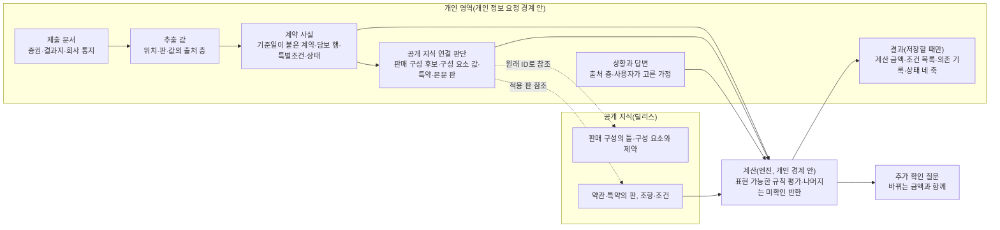

# 개인 계약과 상황 모델 토의 초안 (데이터 모델 묶음 2)

상태: **토의 자료. 미확정.** 2026-10-11(14차 토의 반영) | 바탕: [공개 지식 모델 1차 정리](공개지식_모델_1차_정리.md), [가입 구성 검증 사례](가입구성_사례_굿앤굿1540.md), [전체 구조 1차 정리](전체_구조_1차_정리.md), [불확실·오류 상황 시험](불확실_상황_시험.md) §6

> **표기:** **토의상 제안(사용자)** = 사용자가 토의에서 제시했으나 "이 방향으로 확정해서 반영하라"는 지시가 없는 사항. **검토 의견(구현자)** = 구현자의 초안·의견. **진행 지시(사용자)** = 토의 순서·방식에 대한 지시이며 설계 결정이 아니다. 이 문서에 확정된 설계 결정은 없다.

## 0. 요구와 원칙

### 0.1 13차 요구(진행 지시·토의상 제안·사용자)
- 모델은 "증권 입력 → 상황 선택 → 금액·담보 확인 → 필요한 조건만 추가 확인"을 지원한다.
- 고지·심사·특별조건은 내부에서 철저히 표현한다. 사용자에게 처음부터 전부 입력하거나 읽도록 요구하지 않는다.
- 같은 사례를 사용자 화면 흐름과 내부 계약·근거·계산 구조로 나란히 보인다.
- 확인되지 않은 금액을 확정해 보여 주지 않는다. 그렇다고 확인된 정보까지 막지 않는다.
- 기존 계약의 실제 보장 확인과 새 상품의 가입 가능성 판단을 나눈다. 공개되지 않은 인수 조건을 알아낼 수 있다고 가정하지 않는다.

### 0.2 14차 원칙(토의상 제안·사용자)
> **복잡한 조건은 뒤에 보여 주되, 계산에서는 생략하지 않는다.** 질문을 안 했다는 이유로 "문제없음"이 되면 안 된다.

- 직관성은 질문을 무조건 줄이는 데서 오지 않는다. 사용자가 지금 왜 이 질문에 답해야 하는지 바로 이해하는 데서 온다.
- 내부에서는 미확인을 철저히 유지한다. 화면에서는 금액과 그 의미를 짧고 정확하게 보인다.
- 지급 여부를 바꾸는 조건을 작은 전제 문구로 처리한 채 금액을 확정하지 않는다. 가정 계산을 먼저 보여 줄 수는 있다. 그때는 금액의 의미를 처음부터 밝히고, 확인에 따라 결과가 바뀌게 한다.

> 처음 받는 진단금이라면
> 이 조건에서 계산한 금액은 ○○만 원이에요.
> [이전에 받은 적 있어요]

### 0.3 13차 초안에서 고친 것
| 13차 초안 | 고친 방향 |
|---|---|
| 금액 표현을 확정 / 분기 / 미확정 / 전제 넷 중 하나로 고름 | "확인된 자료 기준 계산"으로 표현한다. 분기·미확인·가정은 함께 붙을 수 있다(§3.4) |
| "이 계약에서 암 진단금을 받은 적 없음"을 묻지 않는 전제로 두고 금액을 보임 | 금액의 의미에 넣는다("처음 받는 진단금이라면") + [이전에 받은 적 있어요] |
| 결과지에 "제자리암" 말이 없으면 악성으로 계산 | 단어를 찾지 못한 것과 진단이 확인된 것은 다르다. [찾지 못했어요·모르겠어요] 경로를 두고, 결과지의 관련 부분을 확인하게 한다 |
| 갑상선 부담보: "지급되지 않을 가능성이 커요" | 확률 근거가 없으므로 뺀다. "예외 적용 여부가 확인되지 않아 지급액 계산을 보류했어요" |
| 가상 증권의 조합을 "실제로 성립한 사실"로 기록 | 이 사례에서는 "이 조합으로 체결됐다고 가정한 시나리오"다. 실제 증권도 이후 변경·해지까지 자동으로 확인해 주지 않는다 |
| 고지는 기본으로 저장하지 않음 → 화면에서 일반 문구로만 | 수집하지 않는 것과 영향이 없는 것은 다르다. 알릴의무 관련 사실은 **확인하지 않음**으로 결과에 남는다. 관련 계약 문서·통지를 다룰 자리를 둔다 |
| 증권 입력 때 확인 세 가지로 고정 | 고정하지 않는다. 첫 탐색에 필요한 최소 항목에서 시작하고, 고른 상황의 금액을 바꾸는 정보만 추가로 확인한다 |

아래 객체 이름은 설명용 작업 이름이다. 필드·스키마를 정하지 않는다.

## 1. 사례: 가정한 시나리오

**이 사례는 "다음 조합으로 체결됐다고 가정한 시나리오"다.** 실제 개인의 자료도, 실제 가입 성립의 증거도 아니다. 상품·특약·약관 조항은 실제 공시 문서(굿앤굿1540(Hi2607) 약관 `9401e98e…`, 사업방법서 `272917da…`)에서 가져왔다.

| 증권 항목(가정) | 값 |
|---|---|
| 상품명 | 무배당 현대해상굿앤굿1540종합보험(Hi2607) |
| 계약일 | 2026-08-20 |
| 계약자 = 피보험자 = 수익자 | 본인(가상 인물 A), 남, 가입 당시 39세 |
| 고지 유형 | 건강고지Ⅰ(8년) |
| 보험기간·납입 | 100세만기, 20년납, 월납 |
| 담보 | ① 상해사망후유장해 1억원(기본계약) ② 보험료납입면제대상 100만원 ③ 암진단Ⅱ(유사암제외) 3,000만원, 100세만기 ④ 유사암진단Ⅱ 600만원, 100세만기 ⑤ 암진단Ⅱ(유사암제외)(갱신형) 2,000만원, 20년만기 갱신 ⑥ 뇌혈관질환진단 1,000만원 ⑦ 허혈심장질환진단 1,000만원 |
| 특별조건 | 특정 신체부위·질병 보장제한부 인수: 갑상선, 부담보 기간 5년 |

**상황(가정).** A가 2027년 1월 위암 진단을 받았다고 한다. 조직검사 결과가 나온 날은 2027-01-05라고 입력한다.

## 2. 화면 흐름과 내부 구조, 나란히

### 단계 1. 증권 입력: 첫 탐색에 필요한 최소 항목

| 사용자가 보는 것 | 내부 |
|---|---|
| 증권 사진이나 PDF를 올린다 | **제출 문서**를 원본 그대로 개인 영역에 보존한다(삭제 흐름 대상) |
| "현대해상 굿앤굿1540(2026.8.20 가입) 증권으로 보고 있어요. 보장 7개를 읽었어요." [고치기] | **추출 값**마다 원문 위치, 추출 판, 값의 출처 층(원문 추출 / 사용자 수정 / 사용자 확인 / 가정)을 둔다. 첫 화면에 필요한 상품명·가입일·담보 목록은 읽은 값을 그대로 보이고 고칠 수 있게 한다. 읽기 확신이 낮은 값은 그 값에 의존하는 결과가 나올 때 묻는다 |
| 계약 요약에 "특별조건 1건 있음" 한 줄 [보기] | **특별조건**의 증권 문구 원문과 해석(부위 갑상선, 기간 5년)을 기록하고 약관 6-2와 연결한다 |
| (묻지 않음) | **계약 상태**는 "증권 발행 시점 기준"으로만 안다. 이후 변경·해지·실효·특별조건 추가는 **미확인**이다. 묻지 않았다고 "유지 중"으로 두지 않는다 |
| (묻지 않음) | **공개 지식 연결**: 판매 구성 후보, 심사 유형 값, 담보 행 → 특약, 특약 → 적용 본문 판. 모두 연결 판단(제안)으로 기록한다(§3.3) |

### 단계 2. 상황 선택: 그 상황이 필요로 하는 것만, 이유와 함께

| 사용자가 보는 것 | 내부 |
|---|---|
| "어떤 일이 있었나요?" → 암 진단 → "어느 부위인가요?" → 위 | **상황**을 기록한다. 지급 사건 분류 후보 둘: 위의 악성신생물(C16, [별표2]) / 위의 제자리신생물([별표11]) |
| "조직검사 결과가 나온 날은요? 보장 시작일과 비교해야 해서 필요해요." → 2027-01-05 | 진단 기준일은 병리검사 결과보고일이다(보통약관 제4조⑩, 2-5 제2조⑨) |
| "그날 이 계약이 유지되고 있었나요? 해지·실효 상태였다면 보장되지 않아서 확인해요." [네] [해지·실효된 적 있어요] [모르겠어요] | 증권으로 알 수 없는 사건일 기준 계약 상태다. 답은 **사용자 진술**로 기록한다. [모르겠어요]면 계산은 하되 이 조건을 금액의 의미에 넣는다 |

### 단계 3. 금액·담보 확인

**사용자가 보는 것(검토 의견·구현자, 문구 예시)**

> **위암 진단으로 이 계약에서 계산해 봤어요**
>
> 이 금액은 **처음 받는 진단금이라는 조건**에서 계산했어요. [이전에 받은 적 있어요]
>
> | 진단서·결과지의 진단이 | 이 조건에서 계산한 금액 |
> |---|---|
> | 악성 위암이면 | 5,000만원(암진단 3,000 + 갱신형 암진단 2,000) + 보험료납입면제대상 100만원. 다음 회차부터 보장보험료 납입면제 대상 |
> | 위의 제자리암이면 | 600만원(유사암진단) |
>
> **아직 어느 쪽인지 확인하지 않았어요.** 진단 내용을 확인하면 적용되는 담보를 좁힐 수 있어요. [진단 확인하기]
>
> 계산에 쓴 자료: 증권(2026.8.20 가입) · 결과 나온 날 2027.1.5(입력) · 그날 계약 유지(답변)
>
> [계산 근거와 확인하지 않은 것 보기]

> **15차 정정:** 금액을 바꿀 수 있는 미확인(이전 지급 여부, 진단 확정 심사, 알릴의무 관련 사실)은 뒤쪽 층이 아니라 금액 바로 아래 "이 금액이 달라질 수 있는 것"에 둔다([세 흐름 화면 초안](개인계약_세흐름_화면초안.md) C3).

**[계산 근거와 확인하지 않은 것 보기]를 열면(뒤쪽 층)**

| 항목 | 상태 | 내용 |
|---|---|---|
| 보장 시작일 | 근거로 확인 | 암 보장개시 2026-11-18(계약일부터 90일이 지난 다음날). 결과 나온 날이 그 뒤 |
| 1년 안 감액 | 근거로 확인 | 이 담보들은 감액 없음(상품안내 p.117) |
| 다른 보험과의 관계 | 근거로 확인 | 이번 담보는 가입금액을 주는 정액형이다. 중복 가입 시 비례보상은 실손보상형 담보에 대한 안내다(약관 p.37) |
| 특별조건 | 증권 기준 판정 | 증권에 적힌 특별조건(갑상선)은 이번 진단 부위와 다름. 증권 이후 추가된 특별조건이 있는지는 확인하지 않음 |
| 처음 받는 진단금인지 | **가정(화면 맨 위에 표시)** | 각 진단 특약은 최초 1회. 이전 지급이 있으면 해당 특약은 0원 |
| 진단 분류 | **미확인(분기)** | 악성 / 제자리암 |
| 그날 계약 유지 | 사용자 진술 | — |
| 진단 확정 방법 | 확인하지 않음 | 약관은 병리 전문의의 조직·혈액 검사 소견 등을 요구한다(보통약관 제4조⑧). 회사 심사 대상 |
| 계약 전 알릴의무 관련 사실 | **확인하지 않음** | 처음부터 수집하지 않았다. 문제가 없다고 판정한 것이 아니다. 회사는 알린 내용이 지급사유에 영향을 미쳤음을 증명하는 경우 등에 보장하지 않을 수 있다(보통약관 제30조④). 회사에서 받은 통지가 있으면 올릴 수 있다 [통지·서류 올리기] |
| 최종 지급 | 회사 판단 | 이 화면의 금액은 확인된 자료 기준 계산이며 지급 결정이 아니다 |

**내부(계산 구조).** 계산은 개인 정보 경계 안의 엔진(D2)이 한다. 입력은 고정된다: 계약 사실의 판, 연결 판단의 판, 지식 릴리스, 상황 입력과 답변. **엔진은 화면에 보이든 안 보이든 표현할 수 있는 규칙을 평가하고, 자료가 없거나 외부 확인이 필요한 조건은 미확인으로 돌려준다(15차 정정).**

| 담보 행 | 연결 특약·조항 | 조건별 판정 | 결과 |
|---|---|---|---|
| ③ 암진단Ⅱ 3,000만 | [맞춤고지Ⅰ] 판 → 본문 2-5 | 보험기간 ✔ / 보장개시 ✔ / 감액 없음 ✔ / 지급 사건 = 미확인(분기) / 최초 1회 = 사용자가 고른 가정 / 계약 유지 = 사용자 진술 / 부담보 = 증권 기준 해당 없음 / 진단 확정 방법·알릴의무 = 확인하지 않음(회사 판단) | 악성 3,000만 · 제자리 0. 위 가정·진술·미확인이 붙은 계산 |
| ⑤ 암진단Ⅱ(갱신형) 2,000만 | [맞춤고지Ⅰ](갱신형) → 본문 2-6 | 위와 같음 + 갱신 이력: 계약일과 20년 보험기간으로 계산하면 첫 보험기간 안 ✔ → 2-6 제3조② 해당 없음 | 악성 2,000만 · 제자리 0 |
| ④ 유사암진단Ⅱ 600만 | [맞춤고지Ⅰ] → 본문 2-7 | 지급 사건 = 미확인(분기) / 종류별 최초 1회 = 사용자가 고른 가정 / 나머지 같음 | 제자리 600만 · 악성 0 |
| ② 보험료납입면제대상 100만 | 의무부가 특약 | 지급사유에 암(유사암 제외) 진단 포함 → 분기 / 최초 1회 = 가정 | 악성 100만 · 제자리 0 |
| 보장보험료 납입면제 | 보통약관 제3조의2, 제30조⑤ | 7대질병의 암, 보장개시 90일 이후, 납입기간 중, 계약 미소멸 → 분기 + 사용자 진술. 갱신형 특약은 갱신 뒤 면제가 이어지지 않음(제3조의2②) | 악성이면 면제 대상 |
| ①⑥⑦ | — | 지급 사건이 이번 상황과 다름 | 해당 없음(화면에서 접음) |

### 단계 4. 필요한 조건만 추가 확인: 왜 묻는지 함께

**사용자가 보는 것**

> **진단 확인하기**
> 진단 내용을 확인하면 적용되는 담보를 좁힐 수 있어요.
> 결과지나 진단서에서 진단명이나 질병코드를 찾아 주세요.
>
> [C로 시작하는 코드가 있어요(예: C16)]
> [D0으로 시작하는 코드, 또는 '제자리암·상피내암'이라는 말이 있어요]
> [찾지 못했어요·모르겠어요]
> [해당 부분 사진 올리기]

| 답 | 화면 | 내부 |
|---|---|---|
| C로 시작하는 코드(예: C16) | "입력하신 코드(C16) 기준으로 계산하면 5,000만원 + 100만원이에요(처음 받는 진단금이라면)." | 지급 사건 = 사용자 진술(C16). 분기 하나로 좁혀진다. 원발부위 규칙(C77~C80) 같은 분류 규칙은 엔진이 적용한다 |
| D0 코드 또는 제자리암 표현 | "600만원이에요(처음 받는 진단금이라면)." | 지급 사건 = 사용자 진술(제자리신생물) |
| 찾지 못했어요·모르겠어요 | 두 갈래를 그대로 둔다. "결과지의 '진단(Diagnosis)'이나 '병리 진단' 부분을 올려 주시면 그 부분만 읽어 확인할게요." | 미확인을 유지한다. **단어를 찾지 못한 것을 악성으로 보지 않는다** |
| 사진 올리기 | 읽은 진단명·코드를 보여 주고 확인받는다 | 제출 문서 + 추출 값(서류 확인 층). 사용자 진술과 따로 저장한다. 회사 확인과도 다른 층이다 |

[이전에 받은 적 있어요]를 누르면 "어느 진단금을 받으셨나요?"로 그 특약만 고르게 하고, 해당 특약을 0원으로 다시 계산한다.

### 변형: 같은 시나리오에서 갑상선암인 경우

특별조건이 금액 바로 옆에 구체적으로 나온다.

> **갑상선암 진단으로 이 계약에서 계산해 봤어요**
>
> 관련 보장: 유사암진단(갑상선암) 가입금액 600만원
>
> **이 부위에 특별조건이 있어요.** 증권: 갑상선, 부담보 5년.
> 예외 적용 여부가 확인되지 않아 **지급액 계산을 보류했어요.** [적용 조건 보기]

| [적용 조건 보기] 안 | 내부 |
|---|---|
| 부담보 기간 안에 생긴 이 부위 질병에는 보험금을 주지 않는 조건이에요 | 약관 6-2. 증권 문구가 판정 근거다 |
| 기간이 언제 시작해 언제 끝나는지: 증권 문구를 확인해 주세요 [증권 해당 부분 보기] | 기간의 시작 기준은 증권 문구로만 정한다. 문구가 불분명하면 미확인으로 둔다 |
| 예외: 부담보 부위 질병의 합병증으로 다른 부위에 생긴 경우 등은 지급될 수 있어요 | 6-2 ⑤ |
| 이 부위 질병이 직접 원인인지는 의사의 진단서와 소견으로 판단해요 | 6-2 ⑦. 회사 판단 |

- 결과지·진단서로 갑상선암 진단이 확인되고 기간 안이 분명해도, 예외 해당 여부는 회사 판단이다. 그래서 금액은 보류로 둔다.
- 기간이 끝난 뒤의 진단으로 확인되면 부담보는 적용되지 않는다. 그때 600만원을 계산한다(같은 가정·확인 표시와 함께).
- 확률 표현("가능성이 커요")은 쓰지 않는다. 확률을 평가한 근거가 없다.

## 3. 내부 구조

### 3.1 구성 (작업 이름)

### 3.2 무엇을 보존하고, 연결하고, 정정·삭제하나

| 대상 | 보존 | 연결 | 정정 | 삭제 |
|---|---|---|---|---|
| 제출 문서(증권, 결과지·진단서 일부, 회사 통지·변경 확인서) | 원본 그대로 | 추출 값의 위치 | 고치지 않는다. 새 문서를 더한다 | 사용자 요청 시 삭제 흐름 |
| 추출 값 | 원문 값, 위치, 추출 판, 출처 층 | 계약 사실·상황의 항목 | 사용자 수정은 층을 더한다. 무엇을 고쳤느냐에 따라 재계산 범위가 다르다 | 문서와 함께 |
| 계약 사실 | 판, 그리고 **기준일**(증권 발행일, 통지일, 진술일) | 공개 지식 연결 | 새 판을 더한다. 증권 뒤의 변경(특약 해지, 감액, 특별조건 추가, 해지·부활)은 통지·확인서·진술로만 들어온다 | 계약 단위 삭제 |
| 공개 지식 연결 판단 | 근거, 상태, 판단 시각, 공개 쪽 원래 ID | 판매 구성 후보, 구성 요소 값, 특약, 적용 본문 판 | 공개 쪽 정정은 변경 항목으로 받는다. 판 번호가 바뀌었다는 이유만으로 무효화하지 않는다 | 계약과 함께 |
| 상황과 답변 | 유형, 날짜, 답변과 그 출처 층, 사용자가 고른 가정 | 계산 요청 | 답변이나 가정을 바꾸면 그것에 의존한 결과만 다시 계산 | 저장하지 않은 것은 세션과 함께 사라짐 |
| 결과 | 사용자가 저장한 것만: 계산 금액, 조건 목록, 의존 기록, 판 묶음, 상태 네 축 | 의존 대상 | 결과 자체는 고치지 않는다. 입력이 바뀌면 상태가 바뀐다 | 삭제 흐름 |

### 3.3 이 계약에 적용된 구성: 근거와 확인 범위

공개 지식은 가입 구성 후보를 확인 수준과 함께 표현한다. 개인 계약은 그 가운데 이 계약에 적용됐다고 **기록된** 구성을, 근거와 기준일과 함께 둔다.

| 구성 요소 | 값 | 근거 | 확인 범위 |
|---|---|---|---|
| 판매 구성 | Hi2607, 2026-08-01~, 대면(후보) | 상품명 표기, 계약일이 판매기간 안. LO-5·LO-6 중 어느 행인지는 정하지 않는다 | 연결 판단(제안). 두 행의 문서가 같아 이번 계산에는 영향이 없다. 영향이 생기면 그 결론만 막는다 |
| 심사 유형 | 건강고지Ⅰ(8년) | 증권 표기(이 사례에서는 가정) | 증권 발행 시점. 이 계약은 부담보가 있어 약관 6-9 제2조①상 무사고 계약전환을 신청할 수 없다(증권 기준). 부담보가 바뀌었다는 서류가 들어오면 다시 평가 |
| 특약의 판 | [맞춤고지Ⅰ] 판 | 심사 유형 + 표기 생략 규칙(약관 p.53) | 연결 판단(규칙 근거). 본문이 같아 이번 금액에는 영향 없음 |
| 담보 조합 | ③과 ⑤를 함께 | 증권 표기(이 사례에서는 **가정한 시나리오**) | 실제 증권이라면 체결 때의 구성을 보여 주는 근거다. 이후 특약 해지·감액은 증권으로 확인되지 않는다 |
| 특별조건 | 갑상선 부담보 5년 | 증권 표기(가정) | 증권 발행 시점. 약관 6-2 ①은 계약 후 알릴의무 위반의 효과 등으로 보장이 제한될 때도 이 특약을 붙일 수 있다고 한다. 그래서 증권 뒤에 추가된 특별조건은 증권만으로 알 수 없다 |
| 계약 상태 | 증권 발행 시점에는 유효 | 증권 | 사건일 기준 상태는 사용자 진술이나 회사 서류로만 들어온다 |
| 적용 본문 판 | 가입 시 판 | 가입일, 이 상품의 갱신 규칙(약관 6-10 ⑤·⑧, 사업방법서 §8다1) | 연결 판단. 갱신형은 갱신 이력이 생기면 다시 판정 |

**검토 의견(구현자):**
- 증권은 "발행 시점에 이렇게 체결됐다"는 근거일 뿐이다. 현재 상태나 사건일 상태의 근거는 아니다.
- 증권에 없는 사실(할증, 다른 인수 제한)은 공개 규칙으로 채우지 않는다. "증권에 표기 없음"과 "없음"을 구분한다.

### 3.4 금액 표현: 확인된 자료 기준 계산과 조건 목록

> **15차에서 바뀜:** 아래 "상태" 여섯 가지는 하나의 목록으로 쓰지 않는다. 별도 축으로 나눈다(§7.1).

**토의상 제안(사용자):** "확정"이라고 하지 않는다. 확인된 자료 기준 계산으로 표현한다. 분기·미확인·가정은 함께 존재할 수 있으므로 넷 중 하나를 고르는 구조를 피한다.

**구조(검토 의견·구현자).** 표시하는 금액마다 다음을 붙인다.
- 계산 금액: 금액이 하나이거나, 분기별 금액이다.
- 쓴 자료: 판 묶음과 원문 위치.
- **조건 목록**: 그 금액이 기대는 조건마다 다음을 둔다.
  - 상태: 근거로 확인 / 서류 확인 / 사용자 진술 / 사용자가 고른 가정 / 미확인 / 확인하지 않음(회사 판단 등)
  - 결과 영향: 적용을 막음 / 결과를 바꿈 / 사용자가 중요하게 봄 / 추가 설명
  - 화면 위치: 금액의 의미 / 금액 옆 / 뒤쪽 층

**화면 규칙.**
1. 결과를 바꾸는 조건이 **가정**이면 금액의 의미 첫 줄에 쓴다("처음 받는 진단금이라면"). 바꾸는 버튼을 함께 둔다.
2. 결과를 바꾸는 조건이 **미확인**이면 둘 중 하나로 한다.
   - 갈리는 값이 적으면 분기로 나란히 보이고, "아직 어느 쪽인지 확인하지 않았어요"와 확인 버튼을 둔다.
   - 갈리는 값을 정할 수 없으면(예외 적용 여부처럼 회사 판단에 달린 경우) 금액 계산을 보류한다. 보장 존재·가입금액·확인된 사실은 계속 보인다.
3. 적용을 막을 수 있는데 **확인하지 않은** 조건(알릴의무, 진단 확정 방법)은 "확인하지 않았어요"로 뒤쪽 층에 둔다. "문제없음"으로 표시하지 않는다. 금액은 "확인된 자료 기준 계산"이라는 표현으로 그 한계를 함께 진다.
4. 묻지 않은 조건도 결과에서 빠지지 않는다. 엔진은 표현할 수 있는 규칙을 평가한다. 자료가 없거나 외부 확인이 필요한 조건은 미확인으로 돌려준다(15차, §7.3).

### 3.5 가정을 쓸 수 있는 때(토의상 제안·사용자)
- **된다:** 사용자가 고른 가상 시나리오. 예: "처음 받는 진단금이라면", 새 상품을 "이 조건으로 든다면".
- **안 된다:** 실제 계약 결과를 바꾸는 미확인 조건을 몰래 기본값으로 넣는 것.
- 사례의 "처음 받는 진단금이라면"이 허용되는 이유는 두 가지다. 화면 맨 위에서 금액의 의미로 드러나고, 사용자가 바로 바꿀 수 있다. 사용자가 그 가정을 받아들인 채로 저장하면, 결과에 "사용자가 고른 가정"으로 남는다.

### 3.6 질문을 고르는 기준
- 묻는 질문은 **고른 상황의 금액을 바꾸는 정보**다. 질문마다 왜 묻는지를 함께 보인다(15차 정정: "이 답으로 정해져요"처럼 확정하지 않고 "진단 내용을 확인하면 적용되는 담보를 좁힐 수 있어요" 정도로 쓴다. 원래 예: "이 답으로 5,000만원과 600만원 중 하나가 정해져요").
- 묻지 않은 정보는 미확인으로 남는다. 결과에 영향을 주면 조건 목록에 나타난다.
- 답의 선택지에는 늘 [모르겠어요]·[찾지 못했어요]를 둔다. 그 답은 미확인을 유지하고, 확인 방법(서류의 어느 부분)을 안내한다.

### 3.7 고지·심사·특별조건의 내부 표현

| 항목 | 처음부터 수집 | 결과에서의 상태 | 다룰 자리 |
|---|---|---|---|
| 심사 유형 | 증권에서 읽는다 | 증권 발행 시점 값. 이후 전환은 미확인 | 계약전환·특약 판을 물을 때 |
| 계약 전 알릴의무(고지) | **수집하지 않는다** | **확인하지 않음.** 판정하지 않으며, "문제없음"으로 표시하지 않는다 | 회사 통지(알릴의무 위반 통지, 보장 제한·해지 통지)나 관련 계약 문서를 사용자가 올리면 계약 사실과 결과 조건에 반영한다 |
| 특별조건(부담보·할증) | 증권 문구를 읽는다 | 증권 기준 판정. 증권 뒤 추가분은 미확인 | 관련 상황에서 금액 옆에 구체적으로. 회사의 부가 통지를 올리면 반영 |
| 회사 인수지침 | 없음 | 해당 없음(비공개) | 추정하지 않는다. 새 상품 판단에서도 마찬가지 |

## 4. 기존 계약의 실제 보장 확인과 새 상품의 가입 가능성 판단

| | 기존 계약의 실제 보장 확인 | 새 상품의 가입 가능성 판단 |
|---|---|---|
| 질문 | "내 계약으로 이 상황에서 무엇을 얼마나 받나" | "이 상품에 들 수 있나, 들면 얼마인가" |
| 근거 | 계약 사실(기준일 있음) + 적용 약관 + 상황·답변 | 공개 지식의 가입 구성 후보 + 사용자의 사실 |
| 말할 수 있는 끝 | 확인된 자료 기준 계산(조건 목록과 함께) | 약관에 존재함, 공개 가입 규칙에 부합함(나이·기간·조합 제약)까지 |
| 말할 수 없는 것 | 회사의 지급 결정, 알릴의무 판단 | 특정인에게 가입 가능함. 인수 결과는 회사 심사로만 정해진다. 비공개 인수지침을 추정하지 않는다 |

**공개 고지 문항(토의상 제안·사용자).**
- 새 상품의 가입 조건을 알아보는 **후단**에서 보여 줄 수 있다.
- 문항마다 상품·판·기준일을 연결한다. 예: 굿앤굿1540(Hi2607) 사업방법서별지 `272917da…` 별첨 p.63 "최근 N년 이내 입원·수술" 문항, 2026-10-11 수집.
- 답변만으로 가입 가능 여부를 예측하지 않는다.

> (예시, 검토 의견·구현자) "이 상품의 공개된 고지 문항이에요(2026.10.11 확인한 판 기준). 답에 따라 가입 여부와 보험료가 정해지고, 판단은 보험회사가 해요."

사용자가 실제 청약·심사 결과를 받으면, 그때 새 계약의 사실(증권, 통지)로 들어온다. 그 전에는 개인 모델에 인수 결과를 저장할 칸이 없다.

## 5. 기존 정본과 부딪히는 곳 (고치지 않음)

| 정본 | 내용 | 이 초안 |
|---|---|---|
| VOCABULARY `contract_version_match` | `ambiguous`이면 "개인 계산 차단" | 모호함이 결과에 영향을 주는 결론만 막는다 |
| VOCABULARY `policy_holdings_status` | `pending_confirmation`은 "계산에 쓰지 않음" | 첫 탐색은 읽은 값으로 보이되 고칠 수 있게 한다. 결과에 영향을 주는 값의 확신이 낮으면 그 값을 확인한다. 결과의 조건 목록에 출처 층이 남는다 |

## 6. 토의할 질문(14차 판, §7에서 답함)
1. 조건 목록의 상태 여섯 가지(근거로 확인 / 서류 확인 / 사용자 진술 / 사용자가 고른 가정 / 미확인 / 확인하지 않음)는 겹치지 않고 충분한가?
2. 분기를 화면에 몇 갈래까지 보이고, 어디서부터 보류로 바꿀까?
3. 사건일 기준 계약 유지 여부를 이 사례처럼 상황 선택 단계에서 묻는 것이 맞나? 증권 입력 단계로 당길 이유가 있나?
4. 회사 통지·계약 변경 확인서를 받는 경로를 첫 탐색에 노출할까, 관련 결과의 뒤쪽 층에만 둘까?

## 7. 15차 토의: 내부 판단과 화면 표현을 분리 (토의상 제안·사용자, 미확정)

사용자가 보험금을 알아보려고 들어왔다가 조건 확인표를 작성하게 되면 원하는 UX와 멀어진다. 조건을 더 늘리지 않는다. 내부 판단과 화면 표현을 나눈다. 화면은 [세 흐름 화면 초안](개인계약_세흐름_화면초안.md)에서 그렸다.

### 7.1 상태는 축으로 나눈다
같은 값이 "서류에서 추출했고, 사용자가 확인했지만, 사건일에도 유효했는지는 미확인"일 수 있다. 여섯 상태 중 하나만 고르면 이 정보가 사라진다.

| 축 | 값의 예 |
|---|---|
| 정보 출처 | 원문 추출(어느 문서의 어디) / 사용자 입력 / 공개 지식 규칙 / 계산 |
| 확인 여부 | 확인 안 됨 / 사용자 확인 / 서류 대조 / 회사 확인 |
| 실제·가정 | 실제 사실 / 사용자가 고른 가정(어느 시나리오 묶음) |
| 누가 확인해야 하나 | 사용자가 답할 수 있음 / 서류로 확인 가능 / 보험회사만 / 의사 소견 |
| 기준 시점(검토 의견·구현자) | 그 값이 언제 기준인가(증권 발행일, 답한 날, 사건일). 위 예의 "사건일에도 유효했는지"를 담는다 |

예: 특별조건 "갑상선 5년"은 다음처럼 읽힌다.
- 출처: 증권 원문 추출
- 확인 여부: 사용자 확인
- 실제·가정: 실제(문서 사례 전체는 가정한 시나리오)
- 기준 시점: 증권 발행일
- 증권 이후 추가·변경 여부: 확인 안 됨, 확인할 수 있는 쪽은 보험회사 또는 회사 통지

### 7.2 금액 분기
- 내부에서는 필요한 경우를 모두 유지한다.
- 화면에는 이해하기 쉬운 분기부터 보이고 질문으로 좁힌다.
- 분기가 많다는 이유만으로 계산을 보류하지 않는다.

### 7.3 엔진의 범위
- 엔진은 **표현할 수 있는 규칙**을 평가한다.
- **자료가 없는 조건**과 **외부 확인이 필요한 조건**은 미확인으로 돌려준다. 확인 주체를 붙인다.
- "회사 판단"이라는 이름을 붙였다고 그 조건의 영향을 뒤쪽에 숨길 수 없다. 금액을 바꿀 수 있는 미확인은 금액 가까이에 둔다(세 흐름 화면 초안 C3).

### 7.4 계약 유지 여부를 묻는 때
- 계약 입력 때 현재 상태를 받을 수 있다.
- 과거 사건 계산에는 사건 당시 상태가 필요하다.
- 이미 확인한 정보가 그 시점을 덮으면 다시 묻지 않는다. 예: "가입 후 해지·실효 없이 유지"를 답한 날보다 앞선 사건일.

### 7.5 회사 통지·서류를 올리는 곳
- 내 보험에 늘 찾을 수 있는 "계약 변경·서류 추가"를 둔다.
- 관련 결과에서도 바로 연결한다.
- 첫 화면의 필수 절차로 만들지 않는다.

### 7.6 문장 정정
- "이 답으로 5,000만원과 600만원 중 하나가 정해져요"는 과도한 확정이다. 코드 첫 글자나 특정 단어 선택 하나로 계약상 분류와 나머지 지급 조건까지 확인됐다고 볼 수 없다. → "진단 내용을 확인하면 적용되는 담보를 좁힐 수 있어요."
- 가능하면 사용자가 코드를 해석하게 하지 않는다. 결과지의 해당 부분을 읽고, 추출한 진단명·코드 등의 사실을 확인받는다. 사진 없이 탐색하는 길도 유지한다.
- "엔진이 모든 조건을 판정한다" → §7.3의 범위로 고쳤다.

### 7.7 세 흐름
| 흐름 | 물음 | 답의 성격 |
|---|---|---|
| 가상 탐색 | "이 상황이라면?" | 사용자가 고른 가정에 따른 금액 |
| 내 계약 확인 | "내 보험에서는?" | 확인된 계약 자료와 부족한 정보에 따른 결과 |
| 실제 사건 확인 | "이 일이 생겼어요" | 사건 자료를 더하고 필요한 조건만 좁혀 확인한 결과 |

같은 데이터와 엔진을 쓰더라도, 기대하는 답의 성격이 달라 화면 문구와 질문 깊이가 다르다.
