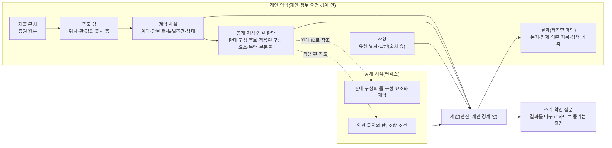

# 개인 계약과 상황 모델 토의 초안 (데이터 모델 묶음 2)

상태: **토의 자료. 미확정.** 2026-10-11 | 바탕: [공개 지식 모델 1차 정리](공개지식_모델_1차_정리.md), [가입 구성 검증 사례](가입구성_사례_굿앤굿1540.md), [전체 구조 1차 정리](전체_구조_1차_정리.md), [불확실·오류 상황 시험](불확실_상황_시험.md) §6

> **표기:** **토의상 제안(사용자)** = 사용자가 토의에서 제시했으나 "이 방향으로 확정해서 반영하라"는 지시가 없는 사항. **검토 의견(구현자)** = 구현자의 초안·의견. **진행 지시(사용자)** = 토의 순서·방식에 대한 지시이며 설계 결정이 아니다. 이 문서에 확정된 설계 결정은 없다.

## 0. 이번 토의의 요구 (진행 지시·토의상 제안·사용자)

1. **경험.** 모델은 "증권 입력 → 상황 선택 → 금액·담보 확인 → 필요한 조건만 추가 확인"을 지원한다.
2. **내부와 화면.** 고지·심사·특별조건은 내부에서 철저히 표현한다. 사용자에게 처음부터 전부 입력하거나 읽도록 요구하지 않는다.
3. **나란히 보이기.** 같은 사례를 두 가지로 나란히 보인다. 사용자가 보는 짧은 화면 흐름과, 그 화면을 뒷받침하는 내부 계약·근거·계산 구조다.
4. **금액 표시.** 확인되지 않은 금액을 확정해 보여 주지 않는다. 그렇다고 확인된 정보까지 함께 막지 않는다.
5. **두 판단의 구분.** 기존 계약의 실제 보장 확인과 새 상품의 가입 가능성 판단을 나눈다. 공개되지 않은 인수 조건을 개인 계약 모델이 알아낼 수 있다고 가정하지 않는다.
6. **방향.** 데이터의 복잡함은 우리가 감당하고, 사용자는 자기 상황과 결과부터 이해하게 한다.

아래 객체 이름은 설명용 작업 이름이다. 필드·스키마를 정하지 않는다.

## 1. 사례: 가상의 증권 한 장

**이 증권은 설명용 가상 사례다.** 실제 개인의 자료가 아니다. 상품·특약·약관 조항은 실제 공시 문서(굿앤굿1540(Hi2607) 약관 `9401e98e…`, 사업방법서 `272917da…`)에서 가져왔다. 증권의 값(사람, 날짜, 가입금액, 특별조건)은 가정이다.

| 증권 항목(가정) | 값 |
|---|---|
| 상품명 | 무배당 현대해상굿앤굿1540종합보험(Hi2607) |
| 계약일 | 2026-08-20 |
| 계약자 = 피보험자 = 수익자 | 본인(가상 인물 A), 남, 가입 당시 39세 |
| 고지 유형 | 건강고지Ⅰ(8년) |
| 보험기간·납입 | 100세만기, 20년납, 월납 |
| 담보 | ① 상해사망후유장해 1억원(기본계약) ② 보험료납입면제대상 100만원 ③ 암진단Ⅱ(유사암제외) 3,000만원, 100세만기 ④ 유사암진단Ⅱ 600만원, 100세만기 ⑤ 암진단Ⅱ(유사암제외)(갱신형) 2,000만원, 20년만기 갱신 ⑥ 뇌혈관질환진단 1,000만원 ⑦ 허혈심장질환진단 1,000만원 |
| 특별조건 | 특정 신체부위·질병 보장제한부 인수: 갑상선, 부담보 기간 5년 |

**상황(가정).** 2027년 1월, A가 위암 진단을 받았다고 한다. 조직검사 결과가 나온 날은 2027-01-05다.

## 2. 화면 흐름과 내부 구조, 나란히

### 단계 1. 증권 입력

| 사용자가 보는 것 | 내부에서 일어나는 일 |
|---|---|
| 증권 사진이나 PDF를 올린다 | **제출 문서**를 개인 영역에 원본 그대로 보존한다. 삭제 표시·삭제 흐름의 대상이다([전체 구조](전체_구조_1차_정리.md) §5) |
| "현대해상 굿앤굿1540, 2026.8.20 가입. 보장 7개를 읽었어요." | **추출 값**마다 원문 위치(쪽·영역), 추출 설정의 판, 값의 출처 층(원문 추출 / 사용자 수정 / 사용자 확인 / 가정)을 둔다 |
| 확인 세 가지만 묻는다: 이 상품이 맞나요? 가입일이 맞나요? 지금도 유지 중인가요? | 읽기 확신이 낮은 값만 추가로 묻는다. 지금 유지 중인지는 증권으로 알 수 없으므로 사용자 진술로 기록한다 |
| 계약 요약에 "특별조건 1건(필요한 상황에서 안내해 드려요)" 한 줄 | **특별조건**(부위 갑상선, 기간 5년)을 계약 사실로 기록하고 약관 6-2와 연결한다. 사용자에게 읽으라고 하지 않는다 |
| — | **공개 지식 연결**(아래 §3.2)을 만든다. 판매 구성 후보, 심사 유형 값, 담보 행에서 특약으로, 특약에서 적용 본문 판으로 잇는다. 사용자에게 묻지 않는다 |

### 단계 2. 상황 선택

| 사용자가 보는 것 | 내부에서 일어나는 일 |
|---|---|
| "어떤 일이 있었나요?" → 암 진단 | **상황**을 기록한다: 유형 = 진단, 대상 = 암 |
| "어느 부위인가요?" → 위 | 지급 사건의 분류 후보를 만든다. 위의 악성신생물(C16, 약관 [별표2])과 위의 제자리신생물(약관 [별표11])이다. 사용자에게 코드를 묻지 않는다 |
| "조직검사 결과가 나온 날은요?" → 2027-01-05 | 진단 기준일은 병리검사 결과보고일이다(보통약관 제4조⑩, 2-5 제2조⑨). 그래서 "진단받은 날"이 아니라 "결과가 나온 날"을 묻는다 |

### 단계 3. 금액·담보 확인

**사용자가 보는 것(검토 의견·구현자, 문구 예시):**

> **위암으로 진단받으셨다면, 이 계약에서 관련된 보장은 4가지예요.**
>
> | 진단 결과가 | 받을 수 있는 금액(약관 기준) |
> |---|---|
> | 일반적인 위암(악성)이면 | **5,000만원**(암진단 3,000만원 + 갱신형 암진단 2,000만원) + 보험료납입면제대상 100만원 |
> | 제자리암(상피내암)이면 | **600만원**(유사암진단) |
>
> 이미 확인된 것:
> - 보장 시작일(2026.11.18) 이후 진단이라 대기기간에 걸리지 않아요
> - 이 보장들은 1년 안 감액이 없어요
> - 특별조건(갑상선)은 이번 상황과 관련이 없어요
> - 다른 보험 가입 여부는 이번 금액에 영향을 주지 않아요(정해진 금액을 주는 보장)
>
> 일반적인 위암이면 다음 회차부터 이 계약의 보장보험료를 내지 않아도 될 수 있어요(납입면제).
>
> 전제: 이 계약에서 암 진단금을 받은 적이 없음
>
> [어느 쪽인지 확인하기] [근거 보기]

**내부(계산 구조).** 계산은 엔진(D2)이 개인 정보 경계 안에서 한다. 입력은 고정된다: 계약 사실의 판, 연결 판단의 판, 지식 릴리스, 상황 입력. 담보마다 다음을 판정한다.

| 담보 행 | 연결 특약·조항 | 조건 판정 | 결과 |
|---|---|---|---|
| ③ 암진단Ⅱ 3,000만 | 암진단Ⅱ(유사암제외)[맞춤고지Ⅰ] → 본문 2-5 | 보험기간 안 ✔ / 보장개시 2026-11-18 이후 ✔(제3조①) / 감액 없음 ✔(상품안내 p.117) / 지급 사건 = "암(유사암 제외)" **분기**(악성이면 ✔, 제자리암이면 ✘) / 최초 1회 = **전제**(이전 지급 없음) / 부담보 = 관련 없음 ✔ | 분기: 악성 3,000만 / 제자리 0 |
| ⑤ 암진단Ⅱ(갱신형) 2,000만 | 같은 계열 [맞춤고지Ⅰ](갱신형) → 본문 2-6 | 위와 같음 + 갱신 이력 = 첫 보험기간(갱신 전) ✔ → 2-6 제3조②(갱신 시 보장개시 재설정) 해당 없음 | 분기: 악성 2,000만 / 제자리 0 |
| ④ 유사암진단Ⅱ 600만 | 유사암진단Ⅱ[맞춤고지Ⅰ] → 본문 2-7 | 지급 사건 = "제자리암" **분기** / 최초 1회(종류별) = 전제 / 부담보 = 관련 없음 ✔ | 분기: 제자리 600만 / 악성 0 |
| ② 보험료납입면제대상 100만 | 의무부가 특약(p.145·147) | 지급사유에 암(유사암 제외) 진단 포함 → **분기** | 분기: 악성 100만 / 제자리 0 |
| 보장보험료 납입면제(보통약관) | 보통약관 제3조의2·제30조⑤ | 7대질병의 암(유사암 제외), 보장개시 90일 이후 → **분기**. 갱신형 특약은 갱신 뒤 면제가 이어지지 않음(제3조의2②) | 분기: 악성 면제 대상 / 제자리 아님 |
| ①⑥⑦ | — | 지급 사건이 이번 상황과 다름 | 해당 없음(화면에서 접음) |

**금액 표현의 규칙(검토 의견·구현자):**
- **확정 금액:** 결과를 바꾸는 미확인 조건이 없을 때만 한 숫자로 보인다.
- **분기 금액:** 미확인 조건 하나가 결과를 가르면, 갈리는 값을 나란히 보인다. 합계 하나로 합치지 않는다. 이 사례의 5,000만원은 "악성이면"이라는 조건이 붙은 분기 값이다.
- **미확정:** 조건이 여럿 얽혀 분기가 커지면 금액을 보이지 않는다. 대신 확인된 사실(보장 있음, 가입금액, 대기기간 통과 등)은 그대로 보인다.
- **전제:** 확인하지 않았지만 결과가 갈릴 가능성이 낮은 조건이다(예: 이전 지급 이력 없음). 묻지 않는다. 화면에 한 줄로 드러내고, 사용자가 아니라고 하면 다시 계산한다.

### 단계 4. 필요한 조건만 추가 확인

| 사용자가 보는 것 | 내부에서 일어나는 일 |
|---|---|
| "조직검사 결과지에 '제자리암', '상피내암', 'in situ' 같은 말이 있나요?" [없어요] [있어요] [모르겠어요 → 결과지 올리기] | **질문 고르기.** 미확인 조건 가운데 ① 결과를 바꾸고 ② 질문 하나로 풀리는 것만 묻는다. 이 사례에서는 지급 사건 분류 하나뿐이다. 부담보·다른 보험·고지 내용은 이번 결과를 바꾸지 않으므로 묻지 않는다 |
| [없어요] → "약관 기준 5,000만원 + 보험료납입면제대상 100만원, 그리고 다음 회차부터 보장보험료 납입면제 대상이에요." | 답을 **사용자 진술**로 기록한다. 결과지를 올리면 **서류 확인**(원문 추출)으로 층이 바뀐다. 둘을 구분해 저장한다 |
| "최종 지급은 보험회사가 진단서·조직검사 결과를 심사해 정해요." [이 금액이 달라질 수 있는 경우] | 회사 심사·계약 전 알릴의무에 대한 회사 판단은 계산에 넣지 않는다. 화면에 "회사 확인 필요"로 남긴다(§4) |

### 변형: 같은 증권, 갑상선암인 경우

이 변형에서 특별조건이 처음으로 화면에 나온다. 관련 있을 때만 나온다.

| 사용자가 보는 것 | 내부 |
|---|---|
| "갑상선암은 이 계약에서 유사암진단(600만원)에 해당해요. 다만 계약할 때 붙은 특별조건(갑상선, 5년)이 있어서, 증권에 적힌 기간(가정: 계약일부터 5년, 2031.8.19까지) 안에 진단됐다면 지급되지 않을 가능성이 커요." [특별조건 자세히] | 유사암진단Ⅱ 2-7(갑상선암 C73)의 지급 사건은 ✔. 부담보 판정은 증권상 부위 "갑상선", 기간 5년으로 한다. 기간의 시작점은 증권 문구를 따른다(이 사례는 계약일부터로 가정). 진단일이 기간 안이면 적용이 막힌다. 다만 6-2 ⑤의 예외(합병증 등)와 ⑦(직접 원인인지는 의사 진단서·의견으로 판단)이 있어 **"가능성이 큼"**으로 표현하고 확정하지 않는다. 납입면제는 해당 없음(유사암은 7대질병이 아님) |
| 부담보 기간이 끝났는지, 범위가 정확히 무엇인지 | 증권 특별조건란의 문구가 판정의 근거다. 문구가 불분명하면 그 하나만 확인한다(증권 해당 부분 다시 보기). 부담보 범위를 정하는 회사의 계약인수지침(6-2 ②)은 공개되지 않으므로 추정하지 않는다 |

## 3. 내부 구조

### 3.1 구성 (작업 이름)

### 3.2 무엇을 보존하고, 연결하고, 정정·삭제하나

| 대상 | 보존 | 연결 | 정정 | 삭제 |
|---|---|---|---|---|
| 제출 문서 | 원본 바이트 그대로 | 추출 값의 위치 | 고치지 않는다. 새 문서를 더한다 | 사용자 요청 시 삭제 표시 → 즉시 삭제(§5 흐름) |
| 추출 값 | 원문 값, 위치, 추출 판, 출처 층 | 계약 사실의 각 항목 | 사용자 수정은 층을 더한다(원문 값을 지우지 않음). 무엇을 고쳤느냐에 따라 재계산 범위가 다르다([불확실 상황](불확실_상황_시험.md) §6) | 문서와 함께 |
| 계약 사실 | 계약 판(유형별 판), 기준일(증권 발행일, 사용자 진술일) | 공개 지식 연결 | 새 판을 더한다 | 계약 단위 삭제 가능 |
| 공개 지식 연결 판단 | 근거, 상태, 판단 시각, 공개 쪽 **원래 ID** | 판매 구성 후보, 적용된 구성 요소 값, 특약, 적용 본문 판 | 공개 쪽 정정(병합 취소 등)은 변경 항목으로 받는다. 연결별로 영향 여부를 판정한다. 판 번호가 바뀌었다는 이유만으로 무효화하지 않는다 | 계약과 함께 |
| 상황 | 유형, 날짜, 답변과 답변의 출처 층 | 계산 요청 | 답변을 바꾸면 그 답변에 의존한 결과만 다시 계산 | 저장하지 않은 상황은 세션과 함께 사라짐 |
| 결과 | 사용자가 저장한 것만. 판 묶음, 분기, 전제, 의존 기록, 상태 네 축 | 의존 대상 | 입력이 바뀌면 상태가 바뀐다. 결과 자체는 고치지 않는다 | 삭제 흐름 |

### 3.3 "적용된 구성"과 "가입 구성 후보"

공개 지식은 **가입 구성 후보**를 확인 수준(약관에 존재 / 공개 규칙 부합 / 특정인 가능)과 함께 표현한다. 개인 계약은 그 가운데 **이 계약에 실제로 적용된 구성**을 기록한다.

| 이 계약의 구성 요소 | 적용된 값 | 근거 | 확인 수준 |
|---|---|---|---|
| 판매 구성 | Hi2607, 2026-08-01~, 대면(후보) | 상품명 표기, 계약일이 판매기간 안. 회사 목록 LO-5·LO-6 중 어느 행인지는 정하지 않는다(두 행의 문서가 같아 계산에 영향 없음) | 연결 판단(제안). 공개 쪽 동일성 판단을 기다림 |
| 심사 유형 | 건강고지Ⅰ(8년) | 증권 표기 | 증권 표기(실제 적용) |
| 특약의 판 | 각 담보의 [맞춤고지Ⅰ] 판 | 심사 유형 + "건강고지Ⅰ의 경우 담보명에서 [맞춤고지Ⅰ] 생략" 규칙(약관 p.53) | 연결 판단(규칙에 근거) |
| 담보 조합 | ③과 ⑤를 함께(비갱신 + 갱신형 암진단) | 증권 | **증권 표기(실제 적용).** 공개 쪽에서는 "공개 규칙상 막히지 않음"까지만 말할 수 있던 조합이다. 이 계약에서는 실제로 성립한 사실이다 |
| 특별조건 | 갑상선 부담보 5년 | 증권 | 증권 표기(실제 적용) |
| 적용 본문 판 | 가입 시 판(2-5·2-6·2-7 등) | 가입일, 이 상품의 갱신 규칙(약관 6-10 ⑤·⑧, 사업방법서 §8다1) | 연결 판단. 갱신형은 갱신 이력이 쌓이면 다시 판정 |

**검토 의견(구현자):**
- 기존 계약에서는 "이 조합이 가입 가능한가"를 다시 판단하지 않는다. 증권이 그 조합이 실제로 성립했다는 근거다.
- 반대로 증권에 없는 사실은 공개 규칙으로 채우지 않는다. 예를 들어 할증이 붙었는지, 인수 때 다른 제한이 있었는지다. 증권에 없으면 "증권에 표기 없음"으로 두고, 결과를 바꾸는 경우에만 확인 질문이 된다.

### 3.4 고지·심사·특별조건의 내부 표현

| 항목 | 내부에서 가진 것 | 가지지 않는 것 | 사용자에게 보이는 때 |
|---|---|---|---|
| 심사 유형 | 증권 표기 값, 그에 따른 특약 판 연결, 계약 중 변경 규칙(약관 6-9: 무사고 계약전환 조건) | 회사가 그 유형으로 받아 준 이유 | 결과를 바꿀 때(이 상품에서는 보장 글이 같아 지급액에는 보통 영향 없음). 계약전환을 물을 때 |
| 계약 전 알릴의무(고지) | 아무것도 묻거나 저장하지 않는다. 기본값이다 | 사용자가 계약 때 무엇을 알렸는지, 고지 위반 여부 | 지급액 화면의 "달라질 수 있는 경우"에 일반 문구로만. 판정하지 않는다(보통약관 제30조④·제20조의 회사 판단) |
| 특별조건(부담보·할증) | 증권 문구 원문, 부위·질병·기간의 해석(출처 층 포함), 약관 6-2·6-5 연결 | 회사 계약인수지침의 기준 | 상황이 그 부위·질병과 관련 있을 때만 |
| 회사 인수지침 | 없음 | 전부(비공개) | 보이지 않는다. 새 상품 판단에서도 추정하지 않는다(§4) |

## 4. 기존 계약의 실제 보장 확인과 새 상품의 가입 가능성 판단

| | 기존 계약의 실제 보장 확인 | 새 상품의 가입 가능성 판단 |
|---|---|---|
| 질문 | "내 계약으로 이 상황에서 무엇을 얼마나 받나" | "이 상품에 들 수 있나, 들면 얼마인가" |
| 근거 | 증권(실제 적용된 구성) + 적용 약관 + 상황 | 공개 지식의 가입 구성 후보 + 사용자의 사실 |
| 말할 수 있는 끝 | 약관 기준 금액, 또는 분기 금액. 최종 지급은 회사 심사 | 약관에 존재함, 공개 가입 규칙에 부합함(가입나이·기간·조합 제약)까지 |
| 말할 수 없는 것 | 회사의 지급 결정, 고지 위반 판단 | **특정인에게 가입 가능함.** 인수 결과는 회사 심사로만 정해진다. 공개되지 않은 인수지침을 추정하지 않는다 |
| 사례 | 위의 위암 사례 | A가 진단 뒤 "암 보장을 더 들 수 있나"를 물을 때 |

**새 상품 쪽 화면 예시(검토 의견·구현자).**

> "이 상품은 가입할 때 '최근 N년 이내 입원·수술' 같은 질문에 답해야 해요(공개된 고지 문항). 답에 따라 가입할 수 있는지와 보험료가 정해지고, 그 판단은 보험회사가 해요. 공개된 가입 조건 중 나이·기간은 맞아요."

- "가입 어려울 거예요"나 "가입 가능해요" 같은 예측을 하지 않는다.
- 사용자가 실제 청약·심사 결과를 받으면, 그 결과는 그때 새 계약의 사실(증권)로 들어온다. 그 전에는 개인 모델에 인수 결과를 저장할 칸이 없다.
- 기존 계약 안의 공개 규칙(예: 이 계약의 무사고 계약전환 조건)은 약관에 있으므로 조건을 보여 줄 수 있다. 승낙 여부는 회사 판단으로 남긴다(약관 6-9 제2조②).

## 5. 이 초안이 지키려는 것 (검토 의견·구현자)

1. **확인된 것은 막지 않는다.**
   - 지급 사건 분류 하나가 미확인이어도 막히는 것은 그 분류에 의존하는 금액뿐이다.
   - 보장 목록, 가입금액, 대기기간 통과, 감액 없음, 특별조건 무관은 그대로 보인다.
2. **결과를 바꾸는 것만 묻는다.** 묻지 않은 조건은 화면에서 숨기지 않는다. "전제"나 "이미 확인된 것"으로 한 줄씩 드러낸다.
3. **답변과 서류를 구분한다.** 사용자 진술, 서류 확인, 회사 확인은 서로 다른 출처 층이다.
4. **공개 쪽 모호함이 개인 계산을 통째로 막지 않는다.** LO-5/LO-6처럼 공개 쪽 판단이 열려 있어도, 그 판단이 계산에 영향을 주지 않으면 계산한다. 영향을 주는 경우에만 그 결론을 막는다.

## 6. 기존 정본과 부딪히는 곳 (고치지 않음)

| 정본 | 내용 | 이 초안 |
|---|---|---|
| VOCABULARY `contract_version_match` | `ambiguous`(후보가 여럿)이면 "개인 계산 차단" | 모호함이 계산 결과에 영향을 주는 경우에만 그 결론을 막는다(§5의 4) |
| VOCABULARY `policy_holdings_status` | `pending_confirmation`은 "계산에 쓰지 않음" | 확인 세 가지(상품·가입일·유지 여부)만 받으면 계산한다. 읽기 확신이 낮은 값이 결과에 영향을 주면 그 값만 묻는다 |

## 7. 토의할 질문

1. 금액 표현 네 가지(확정 / 분기 / 미확정 / 전제)는 적절한가? 분기를 몇 갈래까지 화면에 보일까?
2. "전제"로 묻지 않고 넘어갈 조건의 기준은? 예: 이전 지급 이력은 전제로 두고, 지급 사건 분류는 묻는다.
3. 증권 입력 때 확인 세 가지(상품·가입일·유지 여부) 외에 꼭 받아야 할 것이 있나?
4. 특별조건을 계약 요약에 한 줄로 보이는 것과, 관련 상황에서만 보이는 것 중 어느 쪽인가? 이 초안은 둘 다 한다.
5. 새 상품 쪽 화면에서 공개 고지 문항을 보여 주는 것은 괜찮은가? 고지 문항은 사용자의 사실을 묻는 것이고, 회사 판단을 예측하지는 않는다.
