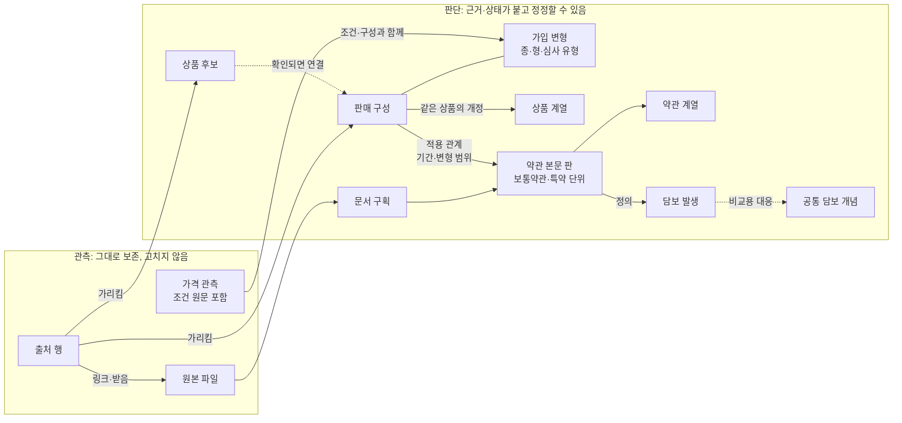

# 공개 보험 지식 모델 토의 초안 (데이터 모델 묶음 1)

상태: **토의 자료. 미확정.** 2026-10-11 | 바탕: [전체 구조 1차 정리](전체_구조_1차_정리.md) §6, [데이터 모델 토의 보완안](데이터모델_토의_보완안.md), [실제 사례로 본 식별 표현](사례_표현_검토.md), [조사 기록](../../research/2026-10-10_source_survey/README.md)

> **표기:** **토의상 제안(사용자)** = 사용자가 토의에서 제시했으나 "이 방향으로 확정해서 반영하라"는 지시가 없는 사항. **검토 의견(구현자)** = 구현자의 초안·의견. **진행 지시(사용자)** = 토의 순서·방식에 대한 지시이며 설계 결정이 아니다. 이 문서에 확정된 설계 결정은 없다.

- **진행 지시(사용자):** 데이터 모델을 세 묶음으로 나눈다. ① 공개 보험 지식 → ② 개인 계약과 상황 → ③ 판단과 결과. 이 문서는 ①이다. 첫 질문은 "무엇이 별개의 대상이며, 어떤 근거로 연결되는가?"이고, 상품·판매 구성·약관 판·담보의 관계부터 본다.
- **토의상 제안(사용자):** 수집한 파일이나 공시 행의 모양이 제품의 데이터 구조를 결정하면 안 된다. 소비자가 보장을 비교하고 사건별 금액을 확인하는 데 필요한 구분이어야 한다. 이 단계의 목표는 "이 두 개는 왜 같고, 저 두 개는 왜 다르며, 그 판단이 틀렸을 때 어떻게 바로잡는가"를 일관되게 설명하는 것이다.
- 이 문서는 **검토 의견(구현자)**이다. 아래의 "판매 구성", "약관 본문 판" 같은 말은 설명용 작업 이름이며 객체명이 아니다. 필드·스키마·ID 형식은 정하지 않는다. 사례 값은 2026-10-10 조사 원본에서 옮겼고, 등급(관측·2차·추정)은 조사 기록을 따른다.
- **11차 토의(2026-10-11):** 사용자가 §9의 질문을 따로 고르지 말고 "소비자가 실제로 비교할 수 있는 가입 구성"을 중심으로 함께 풀자고 제안했다(토의상 제안·사용자, 미확정). §10에 옮겼다. §6의 선택지 1~6은 그 제안으로 다시 정리되며 이력으로 남긴다. 제안을 검증한 사례는 [가입 구성 검증 사례: 굿앤굿1540](가입구성_사례_굿앤굿1540.md)이다.
- 정본과의 관계: SYSTEM_CONTRACT §5의 `ProductVersion`은 "상품 계보·개정판·채널·적용 기간"을 한 객체에 묶는다. 이 초안은 그것을 판매 구성, 상품 계열, 적용 관계로 나눠 보는 안이다. 정본은 고치지 않았다.

## 0. 출발점: 소비자 질문이 요구하는 구분

출처의 행과 파일이 아니라, 소비자 기능이 답해야 하는 질문에서 대상을 정한다.

| 소비자 질문 | 답하려면 구분해야 하는 것 | 출처 모양을 그대로 쓰면 생기는 오류 |
|---|---|---|
| 이 보험으로 무엇을 살 수 있었나(가입 단위) | 회사, 가입 경로, 판매기간, 고를 수 있는 종·형·심사 유형, 붙일 수 있는 특약 | 같은 약관 파일을 쓰는 대면판과 통신판매판을 하나로 셈(§5 사례 1) |
| 어떤 말이 적용되나(보장의 글) | 보통약관·특약 하나하나의 본문 판과, 그 판이 어느 가입 단위·기간·변형에 적용되는지 | 파일 하나를 약관 하나로 봐서, 특약 417개 중 하나만 바뀌어도 전부 바뀐 것으로 처리(사례 2) |
| 이 사건에 무엇을 얼마 주나 | 담보가 정의된 조항, 지급사유·금액·감액·면책, 가입금액 | 이름이 같은 담보를 같은 보장으로 계산(§3.5) |
| 얼마인가 | 가격이 붙은 가입 단위·변형, 가격 조건(나이·성별·만기·납입·심사 유형), 특약 구성 | 건강고지형과 일반심사형 가격을 한 상품의 두 가격으로 섞음(사례 5) |
| 무엇이 바뀌었나 | 바뀐 것이 판매 단위인가, 본문인가, 가격인가 | 약관 그대로 사업방법서만 바뀐 새 판매기간을 "약관 개정"으로 알림(사례 3) |

**검토 의견(구현자):** 그래서 대상은 네 가지 물음에 하나씩 대응한다. 가입 단위는 **판매 구성**, 글은 **약관 본문 판**, 사건 지급은 **담보**, 금액은 **가격 관측**이 맡는다. 출처의 행과 파일은 이 대상들을 가리키는 **관측**으로 보존한다.

## 1. 대상과 구분 이유

| 대상(작업 이름) | 무엇인가 | 성격 | 왜 따로 두나 |
|---|---|---|---|
| **출처 행** | 한 회차에 한 출처가 보여 준 한 줄(회사 공시실 행, 협회 공시행, 다모아 행, 우체국 고시 별표 행, 특약 탭 행) | 관측 | 출처마다 행의 단위가 다르다. 판매기간 단위(회사), 심사 유형·종 단위(협회), 형 단위(다모아), 이름+시행일 단위(우체국). 행을 그대로 대상으로 삼으면 출처 모양이 구조를 정한다 |
| **원본 파일** | 받은 바이트 | 관측 | 한 파일에 약관 수백 개가 들고, 한 약관이 여러 파일에 있다. 재압축하면 해시가 바뀐다 |
| **문서 구획** | 원본 파일의 어느 범위가 어느 보통약관·특약인가 | 판단(구획 규칙의 판 포함) | 파일과 약관을 잇는 다리다. 구획이 틀리면 본문 판이 틀린다 |
| **약관 본문 판** | 보통약관 하나, 또는 특약 하나의 한 판 | 판단 | 보장의 글이 바뀌었는지를 이 단위로 판단해야 영향 범위가 정확하다 |
| **약관 계열** | 같은 보통약관·특약의 여러 판 | 판단 | "이 특약이 개정됐다"를 말하려면 판끼리 이어야 한다 |
| **판매 구성** | 한 회사가 한 판매기간에 한 가입 경로로 판, 소비자가 가입할 수 있었던 단위 | 판단 | 개인 계약이 무엇을 샀는지, 가격이 무엇의 가격인지를 붙이는 자리다 |
| **가입 변형** | 판매 구성 안에서 가입할 때 고르는 종·형·심사 유형 | 판단 | 같은 약관 파일 안에 있어도 적용 조항·가격·가입 조건이 다르다. 판매 구성의 경계는 선택지 1(§6) |
| **상품 계열** | 판매 구성끼리 "같은 상품의 개정·이름 변경"이라는 묶음 | 판단 | 설명·탐색·변경 추적용이다. 계산에 쓸지는 선택지 3 |
| **담보 발생** | 특정 약관 본문 판 안에 정의된 한 담보(지급사유·금액·조건) | 판단(조항 위치는 관측) | 사건 계산의 단위다. 담보는 판매 구성이 아니라 본문 판에 정의된다 |
| **공통 담보 개념** | 상품을 넘어 비교하려고 세우는 담보의 공통 틀(예: 암 진단) | 판단 | 비교용이다. 계산은 발생을 쓰고 개념을 쓰지 않는다(§3.5) |
| **가격 관측** | 출처가 보여 준 한 가격과 그 조건 원문 | 관측(어디에 붙는지는 판단) | 같은 담보라도 심사 유형·조건이 다르면 가격이 다르다. 조건이 다른 가격을 합치지 않는다(PREMIUM_DATA_CONTRACT) |
| **상품 후보** | 어느 출처에서든 발견됐지만 아직 판매 구성에 연결·확인되지 않은 대상 | 판단 | 출처에만 있는 대상도 잃지 않고 추적한다(보완안 §3.2) |

## 2. 관계와 근거

| 관계 | 무엇을 잇나 | 쓸 수 있는 근거 | 그것만으로는 부족한 근거 |
|---|---|---|---|
| 가리킴 | 출처 행 → 판매 구성 / 상품 후보 | 출처 고유 ID의 회차 간 연속, 회사·가입 경로·판매기간·구별 속성 일치 | 상품명, 파일명 속 코드, 약관 해시 |
| 출처 단위 차이 | 출처 행 하나 ↔ 판매 구성 여럿(`covers`), 출처 행 ↔ 판매 구성의 일부(`part_of`) | 채널 병기, 심사 유형별 행, 담보 단위로 펼친 행 | — |
| 구획 | 원본 파일 → 약관 본문 판 | 목차·조항 머리·쪽 범위와 구획 규칙의 판 | 파일 경계 |
| 적용 관계 | 판매 구성(+기간·변형) → 약관 본문 판 | 공시 행의 문서 링크, 사업방법서, 약관 목차, 특약 목록 팝업 | 같은 파일을 받았다는 사실 하나(받은 시점의 판이 판매 당시 판이라는 보장이 없다) |
| 특약 부가 | 판매 구성 → 붙일 수 있는 특약 본문 판 | 특약 팝업·특약 탭, 약관 색인, 사업방법서 | 하나의 출처만. 출처끼리 어긋날 수 있다(사례 2) |
| 같음·다름·개정 | 판매 구성 ↔ 판매 구성 | §3의 표 | 문서 동일성(필요조건도 충분조건도 아님) |
| 정의 | 약관 본문 판 → 담보 발생 | 조항 경로·쪽·인용 | 협회 공시의 담보명 |
| 비교용 대응 | 담보 발생 → 공통 담보 개념 | 정의 조항의 대조(지급사유, 대상 범위, 감액·면책) | 담보명 |
| 가격 연결 | 가격 관측 → 판매 구성·변형·특약 구성·조건 | 조건 원문, 공시행의 상품명·심사 유형, 요약서 | 회사·상품명만 |

**검토 의견(구현자):** 모든 판단 관계에는 근거, 상태(제안 / 확인 / 보류 / 대체됨), 판단 시각, 판단한 규칙이나 사람이 붙는다. 상태 이름은 정하지 않는다. 핵심 규칙은 하나다. **같은 파일이라는 사실은 "같은 본문 판"의 근거가 될 수 있지만, "같은 판매 구성"의 근거는 되지 못한다.**

## 3. 같다와 다르다: 대상별 판정 근거

"이 두 개는 왜 같고, 저 두 개는 왜 다르며, 틀렸을 때 어떻게 바로잡는가"를 대상마다 같은 틀로 적는다.

### 3.1 원본 파일
- **같다:** 바이트 해시가 같다. 관측이므로 틀릴 수 없다.
- **다르다:** 해시가 다르다. 다만 다른 파일이 같은 본문 판을 담을 수 있다(재압축, 통합약관과 특약 별도 파일).
- **틀렸을 때:** 해당 없음. 받은 파일이 손상됐으면 다시 받은 관측을 더한다.

### 3.2 약관 본문 판
- **같다:** 구획의 바이트가 같다. 또는 정규화한 본문 지문(정규화 규칙의 판 포함)·제목·개정 표기가 같다. 뒤쪽은 판단이다(정규화가 차이를 숨길 수 있다).
- **다르다:** 제목은 같은데 본문이 다르다 → 같은 약관 계열의 다른 판.
- **부족한 근거:** 파일명, 파일 크기(현대 1540 두 약관은 10,681,466B로 크기가 같지만 하나만 받았다), 상품명 속 개정 표기.
- **틀렸을 때:** 본문 판을 나누거나 합친다. 그 판에 정의된 **담보 발생**과, 그 판에 걸린 **적용 관계**가 영향 범위다. 변경 항목의 범위를 "이 특약 본문 판"으로 특정할 수 있다.

### 3.3 판매 구성
- **같다:** 출처가 같은 대상이라고 밝힌다(같은 출처 고유 ID의 회차 간 연속). 또는 회사·가입 경로·판매기간·구별 속성(코드, 종·형, 심사 유형, 범주)이 같고, 약관·사업방법서·요약서를 모두 대조했으며, 반대 근거가 없다(보완안 §3.3 조건 1~5).
- **다르다:** 출처 고유 ID가 다르다, 가입 경로 분류가 다르다, 가격·가입 조건이 다른 별도 공시행이 있다.
- **부족한 근거:** 같은 약관 바이트, 같은 이름, 같은 코드, 파일명 속 코드.
- **틀렸을 때:** 보완안 §3.4의 세 경우로 나눈다. ① 이미 있던 둘을 잘못 합침 → 병합 판단을 대체하고 원래 ID를 복원한다. ② 처음부터 하나로 오인 → 나누고, 생성 근거 쪽이 ID를 유지한다. ③ 연결만 잘못 → 연결만 고친다. 영향 범위는 그 판매 구성에 붙은 적용 관계·가격·개인 계약 연결(묶음 2)이다.

### 3.4 상품 계열
- **같다:** 출처 코드가 이어지고 판매기간이 끊김 없이 이어진다(라이프플래닛 prdCd 1000101의 이름 변경). 또는 판본 표기가 차례로 이어지고 이름 본체가 같다(삼성화재 (2601.10) → (2607.11)).
- **다르다:** 같은 코드인데 분류·이름·출처 상품 ID가 다르고 판매기간이 수십 년 끊긴다(교보 1000649).
- **부족한 근거:** 코드 하나, 이름 하나.
- **틀렸을 때:** 계열을 나누거나 잇는다. 계열을 설명·탐색에만 쓰면(선택지 3의 가) 계산 결과는 영향을 받지 않는다.

### 3.5 공통 담보 개념
- **같다:** 정의 조항을 대조했더니 지급사유, 대상 질병·사고의 범위, 감액·면책이 같다.
- **다르다:** 이름이 같아도 정의가 다르다(예: "암진단"인데 유사암을 포함하는지가 다름).
- **부족한 근거:** 담보명. 협회 공시에서 회사-담보명 2,794쌍 가운데 1,717쌍이 같은 회사의 여러 상품에 나온다(B §4, 관측). 이름이 같다고 정의가 같다는 보장은 없다.
- **틀렸을 때:** 개념 대응만 고친다. **사건 계산은 담보 발생(본문)을 쓰므로 영향을 받지 않는다.** 비교 결과만 다시 확인한다. 개념과 발생을 나누는 이유가 여기에 있다.

### 3.6 가격 관측의 대응
- **같다:** 같은 가입 대상(판매 구성·변형·특약 구성)에 대해 조건 집합이 같다.
- **다르다:** 조건 하나라도 다르면(심사 유형, 만기, 납입, 나이·성별) 다른 가격이다. 합치지 않는다.
- **부족한 근거:** 회사와 상품명만.
- **틀렸을 때:** 가격의 연결만 고친다. 가격 비교 결과는 다시 확인하고, 보장 설명과 사건 계산은 유지한다(PREMIUM_DATA_CONTRACT의 "가격 비교만 중단").

## 4. 시간과 판

같은 "날짜"라도 뜻이 다르다. **검토 의견(구현자):** 아래를 섞지 않는다.

| 시간 | 붙는 곳 | 예 |
|---|---|---|
| 관측 시각 | 출처 행, 원본 파일 | 2026-10-10 조사 회차 |
| 출처가 적은 등록·수정 시각 | 출처 행, 원본 파일 | 현대 `regDtm`, 삼성화재 `Last-Modified` |
| 판매기간 | 판매 구성 | `20260101 ~ 20260305` |
| 적용 기간 | 적용 관계(판매 구성 → 본문 판) | 판매기간과 다를 수 있다. 판매기간 안에서 약관이 바뀐 흔적이 있다(사례 3) |
| 특약 판매기간 | 특약 부가 관계 | 주계약 판매기간과 다르다(메트라이프 403/3991) |
| 가격 기준일 | 가격 관측 | 다모아 "2026.10월 기준"처럼 행별 문구로만 나오기도 한다 |
| 판단 시각과 릴리스 | 모든 판단 | 과거 릴리스로 다시 실행하면 당시 결과가 나온다 |

판에 대한 세 가지 규칙(검토 의견·구현자):
1. **관측된 판과 판매 당시 판은 다르다.** 판매가 끝난 뒤 다시 쓰인 파일에서 받은 판은 "관측된 판"이다. 판매 당시 판이라는 근거가 없으면 적용 관계는 미확인이다. 최신 판으로 채우지 않는다.
2. **새 판매 구성이 본문 개정을 뜻하지 않는다.** 약관 그대로 사업방법서만 바뀌어 판매기간이 새로 생기는 경우가 있다. 변경 목록은 "판매 구성 새로 생김 / 본문 판 바뀜 / 가격 바뀜"을 구분한다.
3. **본문 판이 바뀌어도 판매 구성은 그대로일 수 있다.** 판매기간 안에서 약관 파일만 바뀐 흔적이 있다. 이때는 적용 관계가 기간을 나눠 가진다.

## 5. 실제 사례로 검증

다섯 사례 모두 같은 순서로 적는다. 관측 → 대상 → 관계 → 같다·다르다의 근거 → 틀렸을 때 → 소비자 기능에 미치는 영향.

### 사례 1. 같은 약관을 쓰는 다른 판매 구성

**관측**
- 교보 실손Ⅴ 대면(`dgtPdtCd=1001115`, 출처 ID 34905, 분류 PAMS04)과 [D](1001116, 34908, PAMS06 통신판매전용)는 둘 다 2026-06-29에 판매를 시작했다. 다른 URL로 받은 약관이 sha256 `73c7a06a…`로 같다. [D] 행의 파일명에는 대면 코드 `1001115`가 들어 있다(C §3.6, 관측).
- 삼성화재 안전운전 파트너 플러스 (2601.10)의 1종(ZPB201210)과 2종(ZPB256110), 그리고 두 판매기간의 약관 URL 가운데 받은 3개가 sha256 `ddef9886…` 하나다. 이 PDF는 553쪽이고 1종·2종 공용이다(D §3.2, 관측).
- 손보협회 요약서 SEQ 93002(1종)와 93003(2종)은 같은 파일이다(B §4, 관측).

**표현**
- 원본 파일 하나, 약관 본문 판 여럿(보통약관과 특약을 구획한 것), 판매 구성 여럿이다.
- 각 판매 구성에서 같은 본문 판으로 가는 적용 관계가 따로 있다. 삼성화재는 종이 변형 범위(1종 납입면제형 / 2종 일반형)로 적용 관계에 붙는다.
- 교보 대면·[D]는 `distinct_from`이다. 근거는 출처 ID·코드·분류가 다르다는 것이다.

**틀렸을 때**
- 해시로 합쳤다면 ①(이미 있던 둘을 잘못 합침)로 되돌린다. [D] 쪽 원래 ID를 복원하고, 병합 기간에 [D]로 맺은 개인 계약 연결을 다시 확인 대상으로 둔다(묶음 2).

**소비자 기능**
- 보장 비교: 대면과 [D]의 보장 글은 같다고 보여 줄 수 있다. 같은 본문 판이 근거다.
- 가격·가입 경로: 따로 보여야 한다.
- 약관이 바뀌면: 두 판매 구성이 함께 변경 범위에 든다. 본문 판에서 적용 관계를 거꾸로 따라가면 바로 찾을 수 있다.

### 사례 2. 한 파일에 들어 있는 여러 특약

**관측**
- 메트라이프 403/4182 약관(169쪽) 한 파일에 주계약과 특약 색인 25개가 있다. 특약은 A/B형이다. 같은 특약이 특약 탭에 별도 파일로도 공시된다.
- 메트라이프 특약 탭에는 특약 270개, 1,940행이 있다. 파일명 하나에 코드가 여럿인 행이 1,172개다.
- 같은 판매기간의 특약 팝업에는 "(간편)" 특약만 있는데, 주계약 약관의 특약 색인 25개에는 "(간편)"이 없다(C §3.3, 관측).
- 라이프플래닛 치아 약관 134쪽에 주계약과 제도성특약 4종이 함께 있다(C §3.6). 삼성화재 553쪽에는 특약 약 417개가 있다(D §3.2). 현대 1540 약관은 1,468쪽이고 갱신형·비갱신형·[맞춤고지Ⅰ] 변형이 한 파일에 있다(D §3.3).

**표현**
- 원본 파일 → 문서 구획(보통약관 1 + 특약 n) → 약관 본문 판 n+1.
- 통합약관 안의 특약 구획과 특약 탭 파일이 같은 본문 판이면 같은 판으로 판단한다. 근거는 본문 지문이다.
- 특약 부가 관계(판매 구성 → 특약)의 근거가 둘이다(팝업과 색인). 서로 어긋나면 둘 다 근거로 보존하고 관계를 **보류**한다. 어느 쪽이 맞는지는 사업방법서로 확인한다(조사).

**틀렸을 때**
- 구획 오류(특약 경계를 잘못 자름)이면 구획 규칙의 판을 고치고 본문 판을 다시 만든다.
- 영향 범위는 그 특약 본문 판에 정의된 담보 발생, 그리고 그 판을 쓰는 적용 관계다. 같은 파일의 다른 특약 416개는 범위 밖이다.

**소비자 기능**
- 사건 계산: 담보가 정의된 특약 본문을 정확히 인용할 수 있다.
- 변경 알림: 파일 단위로 판을 잡으면 특약 하나가 바뀌어도 그 파일을 쓰는 모든 상품·계약이 "약관 바뀜"으로 뜬다. 넓은 재검토가 되어 소비자에게 의미 없는 알림이 늘어난다.
- 특약 목록: 팝업과 색인이 어긋난 동안 "붙일 수 있는 특약"은 미확인으로 보여야 한다. 확인된 주계약 보장 설명은 계속 제공한다(공통 규칙).

### 사례 3. 같은 상품의 개정

**관측**
- 삼성화재 안전운전 파트너 플러스는 판본 (2302.5) → (2404.6) → (2501.7) → (2504.8) → (2511.9) → (2601.10) → (2607.11)로 이어지고, 판본마다 코드 끝자리가 바뀐다(ZPB201160 → … → 220). 같은 판본 안에서도 판매기간이 여러 번 끊긴다. (2601.10)의 1~3월 기간 약관은 판매가 끝난 뒤인 03-26에 쓰였다(D §3.2).
- 메트라이프 403(무배당 더해주고채워주는정기보험)은 판매기간이 28개다. 2026년 1·2~3·4~6월 세 행이 같은 약관 `…_12199_20260101.pdf`를 쓰고 사업방법서만 바뀌었다(C §3.3).
- 라이프플래닛 prdCd 1000101은 같은 코드로 이름이 세 번 바뀌었다. 치아보험 2026-04-01~ 판매기간에 약관 파일은 `20260701_10043_03.pdf`(PDF 생성일 2026-06-29)다. 2026-04-01 당시 약관은 목록 어디에도 없다(C §3.5).
- 현대 1540: 2026-07-01~07-31 행은 범주 0302, 08-01~ 행은 범주 0308이다(D §3.3).

**표현**
- 판매기간마다 판매 구성을 두고, 판매 구성끼리 상품 계열로 잇는다. 메트라이프 403은 계열 하나에 판매 구성 28개다.
- 본문 판은 판매 구성과 별도로 이어진다. 메트라이프 1~6월 세 판매 구성은 본문 판 하나를 공유한다. 그래서 "판매 구성은 새로 생겼지만 약관은 같다"를 표현할 수 있다.
- 라이프플래닛 치아의 적용 관계는 기간을 나눈다. 2026-07-01 무렵 이후는 관측된 판이다. 2026-04-01 ~ 그 전은 "관측 없음, 적용 판 미확인"이다. 정확한 경계일도 미확인이다.
- 삼성화재 (2601.10)의 1~3월 기간: "관측된 판 `ddef9886…`, 판매 당시 판 미확인."

**틀렸을 때**
- 계열을 잘못 이었으면 계열만 고친다.
- 적용 관계 기간이 틀렸으면 그 판매 구성·기간에 맺은 계약의 적용 약관이 다시 확인 대상이 된다(묶음 2로 넘기는 연결).

**소비자 기능**
- 사건 계산: 가입일에 해당하는 적용 관계를 쓴다. 판매 당시 판을 모르면 금액을 확정하지 않고 "관측된 판 기준, 가입 당시 판 미확인"으로 보여 준다. 최신 약관으로 계산하지 않는다.
- 변경 알림: 메트라이프의 경우 "새 판매기간, 약관 같음"으로 구분돼 보장 재검토를 요구하지 않는다.

### 사례 4. 코드 재사용(과 반대 경우)

**관측**
- 교보 `dgtPdtCd=1000649`는 출처 상품 ID 248 "연금저축교보연금보험"(판매기간 74개, 2003~현재)과 ID 50 "자유설계투자수익보험"(1983-04-20~09-30)에 함께 붙는다. 분류도 PAMS02와 PAMS03으로 다르다. 이렇게 재사용된 코드가 222개다(C §3.2·§5).
- 삼성화재 코드 40003·JD5575는 서로 다른 특약에 재사용된다. 코드 ZPT001040 하나에 이름이 16개다. JD5517 행은 TL5805 파일을 쓴다(D §4, §3.2).
- 반대 경우: 라이프플래닛 prdCd 1999901과 1005207은 이름·판매기간이 같고 같은 파일을 쓴다(C §3.5).

**표현**
- 코드는 출처 식별자로 보존한다. 대상을 만들거나 합치는 키가 아니다.
- 1000649는 상품 계열 둘(L-248, L-50)로 나뉘고, 그 사이에 계열 관계를 만들지 않는다. 코드 충돌은 따로 기록한다.
- 라이프플래닛 두 코드는 판매 구성 쌍으로 두고 **보류**한다. 해석 후보는 셋이다. 코드 이전, 같은 문서를 쓰는 다른 판매 구성(`intyCd`가 다름), 목록 중복.

**틀렸을 때**
- 코드로 묶었다면 ②(처음부터 하나로 오인)로 나눈다. 생성 근거(먼저 만든 출처 행) 쪽이 ID를 유지하고, 1983년 쪽은 새 ID를 받는다.
- 1983년 상품에 연결된 개인 계약은 다시 확인 대상이다.

**소비자 기능**
- 계열을 계산에 쓰면 2026년 개정이 1983년 계약의 영향 범위에 들어가고, 1983년 계약을 연금저축 상품으로 설명한다.
- 계열을 설명용으로만 쓰면 계산은 판매 구성과 적용 관계만 따르므로 이 오류가 계산으로 번지지 않는다(선택지 3).

### 사례 5. 출처에만 있는 미확인 후보

**관측**
- 손보협회 비교공시에 현대 1540(Hi2607)이 공시행 둘로 있다.
  - `N09PB144455` 건강고지Ⅰ: 남 37,820원 / 여 28,790원
  - `N09PB144456` 일반심사: 남 55,480원 / 여 42,010원
  - 담보 6개와 금액은 같다. 협회 공시에는 판매기간 필드가 없고, 약관과 사업방법서도 없다(B §3.1).
- 현대 회사 목록에는 같은 이름·같은 개시일 행이 둘(LO-5, LO-6) 있다. 이 둘이 협회의 두 심사 유형인지는 **가설이고 확인하지 않았다.**
- 같은 곳에서 회사·상품명이 같은데 `TP_CODE`가 다른 쌍이 23개다(예: DB 2607(15종)의 적립이율 1.8과 1.75)(B §4).
- 다모아에는 삼성화재 같은 상품의 (2504.17)판과 (2601.19)판이 동시에 게재돼 있다(E §3.4).
- 생보협회 배타적사용권 목록에는 상품 없이 특약만 있는 항목과, 한 행에 "외 N종"이 있다(A §3.1).
- 우체국 고시 별표에는 상품코드가 없고, 같은 이름의 특약 18개가 시행일만 달리 중복된다(E §3.2).

**표현**
- 출처 행은 하나도 빠짐없이 기존 판매 구성, 기존 후보, 새 후보 가운데 하나를 가리킨다.
- 협회 두 행은 상품 후보 둘이 된다. 판매 구성과의 관계는 **제안** 상태이고, 단위 차이(`part_of` 또는 변형 대응)를 함께 적는다.
- 후보에 붙은 가격 관측은 **후보의 가격**으로 보존한다. 판매 구성 연결이 확인되기 전에는 판매 구성의 가격으로 쓰지 않는다.
- 다모아의 옛 판 행은 판매 상태의 근거로 쓰지 않는다. 다모아 스스로 "실제 판매와 상이할 수 있음"이라고 적는다.

**틀렸을 때**
- 후보를 엉뚱한 판매 구성에 이었다면 ③(연결만 잘못)으로 고친다. 후보 ID는 그대로다.
- 그 연결로 판매 구성에 붙었던 가격 비교 결과만 다시 확인한다.

**소비자 기능**
- 가격 비교: 건강고지Ⅰ·일반심사 가격을 "같은 담보, 다른 심사 유형"으로 보여 줄 수 있다. 사용자에게 맞는 심사 유형은 사용자의 사실로 확인한다. 약관 해석을 사용자에게 넘기지 않는다.
- 보장 설명: 후보만 있고 약관이 없으면 협회 담보명·금액은 출처 사실로 보여 줄 수 있다. 지급 조건은 확정하지 않는다.
- 비교 범위: 후보도 비교 범위에 "판매 구성 미확인"으로 나타난다. 빠뜨리지 않는다.

### 사례들이 보여 준 것: 같은 구분이 출처마다 다른 모양으로 온다

심사 유형이라는 하나의 구분이 출처마다 다른 모양으로 나타난다.

| 출처 | 나타나는 모양 |
|---|---|
| AIA | 판매기간마다 1형 통약관(간편심사형)과 2형 통약관(일반심사형)이 **파일로** 나뉜다(C §3.4) |
| 현대 | 갱신형·비갱신형·[맞춤고지Ⅰ] 변형이 **한 파일**에 있다(D §3.3) |
| 손보협회 | 심사 유형이 **공시행으로** 나뉜다 |
| 현대 회사 목록 | 같은 이름 **두 행**으로 나뉘는지 알 수 없다 |

출처 모양을 따르면 같은 구분이 회사마다 다른 구조로 저장된다. **검토 의견(구현자):** 심사 유형은 출처 모양과 상관없이 같은 자리(선택지 1에서 정하는 곳)에 두고, 출처의 모양은 관측과 근거로만 남긴다.

## 6. 선택지와 그 영향

> **11차 토의 뒤:** 아래 선택지 1~6은 §10의 토의상 제안(사용자)으로 함께 다시 정리됐다. 이 절은 이력으로 남긴다.

채택은 토의 뒤에 한다. 각 선택지가 소비자 기능과 데이터 정확성을 어떻게 바꾸는지만 적는다.

### 선택지 1. 판매 구성의 경계: 종·형·심사 유형·가입 경로

| 안 | 내용 | 소비자 기능 | 데이터 정확성 |
|---|---|---|---|
| (가) 모두 별개의 판매 구성 | 종·형·심사 유형·가입 경로가 다르면 판매 구성이 다르다 | 가격·가입 조건이 깔끔하게 붙는다. 같은 상품이 여러 개로 보이므로 화면에서 다시 묶어야 한다 | 출처가 구분해 주지 않는 경우(현대 LO-5/LO-6, 한 파일에 든 변형)에는 판매 구성을 만들 근거가 부족해 보류가 많아진다 |
| (나) 판매 구성 하나 + 가입 변형 | 회사·가입 경로·판매기간으로 판매 구성을 정하고, 종·형·심사 유형은 그 안의 변형 | "한 상품, 고르는 선택지"로 보여 주기 쉽다. 사건 계산은 변형별 적용 조항을 따라야 한다(1종 납입면제형 등) | 실제로 따로 인가·판매된 단위를 변형으로 접으면 차이를 숨길 위험이 있다. 가격·가입 조건·적용 범위가 변형 단위로 붙어야 한다 |
| (다) 기준을 소비자 차이로 정함 | 가입할 때 따로 고르는 선택이고 보장 글·가격·가입 조건 중 하나라도 달라지면 변형으로 나눈다. 가입 경로가 다르면 판매 구성을 나눈다 | (나)와 같다. 변형의 기준이 출처가 아니라 소비자 차이다 | 출처가 행을 나누든 파일을 나누든 같은 자리에 들어간다. 변형 기준을 확인할 근거(사업방법서)를 받아야 한다 |

**검토 의견(구현자):** (다)가 "출처 모양이 구조를 정하지 않는다"에 가장 가깝다. 다만 가입 경로를 판매 구성의 경계로 둘지, 변형으로 둘지는 열어 둔다. 교보 대면/[D]는 출처가 코드를 따로 주고 가격 공시도 따로일 가능성이 높아 경계로 보는 쪽이 자연스럽지만, 확인하지 않았다.

### 선택지 2. 약관 본문 판의 단위

| 안 | 소비자 기능 | 데이터 정확성 |
|---|---|---|
| (가) 파일 단위 | 특약 하나가 바뀌어도 그 파일을 쓰는 모든 상품이 "약관 바뀜"이 된다. 알림과 재검토가 넓어진다 | 구획 오류는 없지만 영향 범위를 특정하지 못한다. "범위 특정 안 됨" 변경이 늘어난다 |
| (나) 보통약관·특약 단위 | 바뀐 특약을 쓰는 상품·계약만 다시 확인한다. 담보 인용도 정확하다 | 구획 단계가 필요하고, 구획이 틀릴 수 있다. 구획 규칙의 판과 근거를 남겨 정정할 수 있게 한다 |
| (다) 조항 단위까지 | 바뀐 조항에 의존하는 결론만 다시 확인한다. 가장 좁다 | 조항 경로 추출 비용과 오류가 크다. 의존 기록(묶음 3)이 조항까지 내려가야 의미가 있다 |

**검토 의견(구현자):** 판은 (나)로 잡고, 조항은 판 안의 위치(인용·의존 대상)로 쓰는 안을 토의하자. (다)의 이득은 판을 조항 단위로 쪼개지 않아도 의존 기록이 조항을 가리키면 얻을 수 있다.

### 선택지 3. 상품 계열을 어디까지 쓰나

| 안 | 소비자 기능 | 데이터 정확성 |
|---|---|---|
| (가) 설명·탐색·변경 추적에만 | "이 상품의 이전 판" 같은 설명과 개정 이력을 보여 준다. 계산과 개인 계약 연결은 판매 구성·적용 관계만 쓴다 | 계열 오류(코드 재사용)가 계산으로 번지지 않는다 |
| (나) 개인 계약 연결의 보조 근거로도 | 증권에 판매기간이 없을 때 같은 계열의 판매 구성 중에서 후보를 좁힐 수 있다 | 계열이 틀리면 후보가 틀린다. 보조 근거로만 쓰고 확정 근거로 쓰지 않아야 한다 |

### 선택지 4. 상품 후보의 형태(보완안 §3.2에서 이어짐)

| 안 | 소비자 기능 | 데이터 정확성 |
|---|---|---|
| (가) 판매 구성과 같은 종류에 "후보" 상태 | 확인되면 같은 ID가 판매 구성이 된다. 화면·개인 연결이 ID를 바꾸지 않는다 | 출처 단위가 판매 구성과 다른 경우(협회 심사 유형 행이 판매 구성의 변형에 해당) 억지로 판매 구성 하나에 맞추게 된다 |
| (나) 별도 종류, 판매 구성에 연결 | 후보와 판매 구성이 따로 보인다. 화면이 둘을 함께 다뤄야 한다 | `covers`·`part_of`·변형 대응을 담기 쉽다. 후보 하나가 판매 구성 둘에 걸려도 표현된다 |

### 선택지 5. 공통 담보 개념의 대응 기준

| 안 | 소비자 기능 | 데이터 정확성 |
|---|---|---|
| (가) 담보명으로 대응 | 많은 상품을 빨리 비교한다 | "같은 이름, 다른 보장"을 같다고 보여 준다. 소비자가 가장 오해하기 쉬운 지점이다 |
| (나) 정의 조항을 대조해 대응 | 비교 대상이 줄지만, 차이(유사암 포함 여부 등)를 근거와 함께 보여 준다 | 대조 전에는 대응이 미확인이다. 이름이 같다는 것은 후보로만 쓴다 |
| (다) 대응하지 않고 발생끼리 직접 비교 | 비교 화면마다 조합을 새로 판단한다 | 공통 틀이 없어 같은 판단을 반복하고, 비교마다 결과가 흔들릴 수 있다 |

### 선택지 6. 가격을 어디에 붙이나

| 안 | 소비자 기능 | 데이터 정확성 |
|---|---|---|
| (가) 판매 구성 | 단순하다 | 심사 유형·종이 다른 가격이 한 판매 구성에 여러 개 붙는다. 조건으로 구분하지 않으면 섞인다 |
| (나) 가입 변형 + 특약 구성 + 조건 | 사용자 조건에 맞는 가격만 골라 보여 줄 수 있다 | 변형이 확인되지 않은 가격(후보의 가격)은 따로 남는다. 선택지 1·4와 함께 정해야 한다 |

## 7. 무엇을 보존하고, 연결하고, 정정·삭제할 수 있어야 하나 (묶음 1 정리)

| 기준 | 공개 보험 지식에서 |
|---|---|
| **보존** | 출처 행·원본 파일·가격 관측은 그대로 보존한다. 판단은 대체돼도 지우지 않는다. 릴리스는 그 시점의 판단 집합을 고정한다. 원본을 얼마나 오래, 어디에 보존할지는 실행 권한 X1로 미정이다 |
| **연결** | 출처 행 → 판매 구성·후보, 파일 → 구획 → 본문 판, 판매 구성(+기간·변형) → 본문 판, 판매 구성 → 특약, 본문 판 → 담보 발생 → 공통 개념, 가격 → 변형·구성·조건. 모든 연결에 근거와 상태가 붙는다 |
| **정정** | 같음·다름·계열·구획·적용 관계·특약 부가·담보 대응·가격 연결을 각각 따로 고칠 수 있어야 한다. 무엇을 고쳤는지가 변경 항목의 범위를 정한다. 한 판단의 정정이 다른 판단을 끌고 가지 않게 나눠 둔 것이 이 구조다 |
| **삭제** | 공개 영역에는 개인 정보가 없으므로 개인 삭제 대상이 없다. 공개 쪽의 "지움"은 판단의 철회(대체)이고 관측은 남긴다. 권리상 원본을 내보일 수 없는 경우의 처리는 원본 재배포 범위 미정과 함께 남는다 |

## 8. 묶음 2로 넘길 것

- 개인 계약은 판매 구성(+변형)과 가입일로 적용 관계를 고른다. 사용자가 확인한 **원래 판매 구성 ID**를 기록한다. 병합 대표 ID가 아니다(보완안 §4).
- 판매 당시 판이 미확인인 적용 관계에 연결된 계약은 "관측된 판 기준"으로 표시한다. 그 표시가 결과에 어떻게 전달되는지는 묶음 3.
- 공개 쪽 판단이 정정되면(병합 취소, 계열 분리, 적용 기간 정정) 개인 영역이 받을 변경 항목의 범위.

## 9. 토의할 질문

1. 선택지 1: 심사 유형·종·형은 판매 구성을 나누는가, 변형인가? 가입 경로(대면·통신판매)는 어느 쪽인가?
2. 선택지 2: 약관 본문 판을 보통약관·특약 단위로 잡고, 조항은 판 안의 위치로 쓰는 안을 토의할 만한가?
3. 선택지 3: 상품 계열을 계산·개인 연결에서 빼고 설명·탐색에만 쓰는가?
4. 선택지 4·6: 후보와 그 가격을 판매 구성과 따로 두는가?
5. 선택지 5: 공통 담보 개념은 정의 대조로만 대응하는가?
6. 조사로 확인할 것: 현대 LO-5/LO-6와 협회 두 행의 관계(사업방법서 대조), 메트라이프 팝업과 약관 색인의 불일치, 라이프플래닛 1999901/1005207의 관계, 판매기간 안의 약관 교체가 실제로 적용 판의 변경인지.

## 10. 11차 토의: 가입 구성을 중심으로 다시 정리 (토의상 제안·사용자, 미확정)

### 10.1 상품 아래에 선택 요소를 두고, 실제로 가능한 조합을 표현한다

> **12차에서 바뀜(토의상 제안·사용자):** 내부 개념 이름은 "선택 요소"가 아니라 **구성 요소**이고, "유효한 가입 구성"은 확인 수준에 따라 **가입 구성 후보**로 부른다. §11 참조.

심사 유형·종·형·채널을 전부 상품으로 쪼개면 중복이 폭발한다. 모두 속성으로만 넣으면 서로 다른 조건이 섞인다.

| 구분 | 역할 |
|---|---|
| 상품·계열 | 소비자가 상품을 찾고 개정 흐름을 이해하는 단위 |
| 판매 구성 | 특정 시기에 제시된 가입 조건과 구성의 틀 |
| 선택 요소 | 종·형·심사 유형·가입금액·특약 등 구별 요소 |
| 유효한 가입 구성 | 그 틀 안에서 실제 허용되는 선택의 조합 |

- 선택 요소라고 해서 사용자가 자유롭게 고를 수 있다는 뜻은 아니다. 심사 결과에 따라 적용되거나 특정 채널에서만 제공될 수도 있다. 가능한 조합과 선택·적용 조건까지 표현한다.
- 가격이 달라졌다는 사실만으로 판매 구성을 나누지 않는다. 나이·가입금액·기준일에 따라 가격이 다른 경우까지 별개 구성으로 만들면 안 된다. 먼저 무엇 때문에 달라졌는지를 구분한다.

### 10.2 약관 판은 보통약관·특약 단위로 관리하되, 조항은 위치 이상이어야 한다

특약 하나만 바뀌었을 때 그 특약을 추적할 수 있어야 한다. 그 안에서도 어느 조항의 어떤 조건이 바뀌었는지 알아야 영향받는 계산을 찾을 수 있다. 세 수준을 연결한다.

| 수준 | 답하는 질문 |
|---|---|
| 원본 파일·구획 | 실제 근거가 어디에 있는가 |
| 약관·특약의 판 | 어떤 문서 내용과 적용 범위인가 |
| 조항·조건의 버전별 연결 | 무엇이 바뀌고 어떤 규칙에 영향을 주는가 |

조항 번호가 같다고 같은 내용으로 보거나, 번호가 바뀌었다고 다른 조건으로 판단하지 않는다. 본문이 같더라도 참조하는 정의·별표가 바뀌면 의미가 달라질 수 있다.

### 10.3 상품 계열은 탐색에 쓰고, 적용 약관이나 계산을 확정하는 근거로 쓰지 않는다

개인 계약 연결에서 완전히 배제할 필요는 없다. 후보를 찾는 단서로 쓸 수 있다. 다만 계열이 같다는 이유로 특정 판매 구성에 연결을 확정하지 못하게 한다.

### 10.4 나머지 세 항목

| 항목 | 제안 |
|---|---|
| 미확인 후보 | 출처에서 발견한 대상을 추적한다. 아직 상품인지 특약인지 구성 묶음인지 모르면 유형을 억지로 확정하지 않는다 |
| 담보 대응 | 이름이나 정의 하나로 동일성을 판정하지 않는다. 지급 사건·제외·기간·횟수·한도·금액 산식 등 비교 축별로 대응한다 |
| 가격 관측 | 독립적으로 보존하고 출처·기준일·산출 조건·구성 내역과 연결한다. 상품 연결이 미확인이어도 관측 자체는 잃지 않는다 |

"같은 담보인가?"보다 "어떤 축에서 비교할 수 있는가?"가 소비자에게 더 유용하다. 두 담보가 동일하지 않아도, 같은 사건에서 지급 조건이 어떻게 다른지는 비교할 수 있어야 한다.

### 10.5 §6 선택지와의 대응(검토 의견·구현자)

| §6 선택지 | 11차 제안으로 |
|---|---|
| 1 판매 구성의 경계 | 판매 구성은 틀, 종·형·심사 유형·채널·특약·가입금액은 선택 요소, 가능한 조합은 유효한 가입 구성(10.1) |
| 2 약관 본문 판의 단위 | 보통약관·특약 단위 + 조항·조건의 버전별 연결(10.2). 구현자 안의 "조항은 판 안의 위치"는 부족했다 |
| 3 상품 계열 | 탐색용, 개인 연결에서는 후보 단서까지만(10.3) |
| 4 상품 후보의 형태 | 유형을 억지로 정하지 않는 후보(10.4). (가)·(나) 둘 다 유형을 먼저 정하는 안이었다 |
| 5 공통 담보 개념 | 비교 축별 대응(10.4) |
| 6 가격 | 독립 관측 + 출처·기준일·조건·구성 연결(10.4) |

검증: [가입 구성 검증 사례: 굿앤굿1540](가입구성_사례_굿앤굿1540.md).

## 11. 12차 토의: 구조는 유지하고 확인 수준을 나눈다 (토의상 제안·사용자, 미확정)

**구조.** 새 상자를 더하지 않는다. 상품 → 판매 구성의 틀 → 구성 요소와 제약 → 가입 구성 후보를 두고, 여기에 약관·담보·가격 관측을 연결한다.

**구성 요소와 정해지는 방식.** "선택 요소"는 사용자가 자유롭게 고른다는 인상을 준다. 그래서 내부 개념은 구성 요소로 두고, 정해지는 방식을 붙인다.
- ① 사용자 선택
- ② 고지·심사에 따른 결정
- ③ 필수 부가
- ④ 다른 구성에 따른 종속
- ⑤ 계약 중 사건에 따른 변경

**모델링 제안과 관측을 구분한다.** 예를 들어 "심사 유형은 판매 구성 안의 한 축"은 관측이 아니라 설계 방식이다. 관측은 "같은 약관 본문을 공유한다, 특정 조건에서 유형 전환이 가능하다"까지다.

**가입 구성의 확인 수준.**

| 확인한 것 | 뜻 |
|---|---|
| 약관에 존재함 | 해당 보장이나 구성에 관한 조항이 있음 |
| 공개 가입 규칙에 부합함 | 확보한 자료상 조합 제한을 충족함 |
| 특정인에게 가입 가능함 | 그 사람의 인수 결과까지 확인됨 |

첫 번째만 확인했다고 두 번째나 세 번째까지 성립하지 않는다. 필요한 자료가 없으면 "가입 구성 후보를 표현할 수 있다"고만 말한다.

**상태를 하나의 목록으로 섞지 않는다.** 각 주장에 대해 다음을 따로 둔다.
- 무엇을 근거로 알았는가
- 무엇을 확인했는가
- 무엇이 가정인가
- 무엇이 남았는가

모든 조합에 상태 하나만 붙이면 정보가 사라진다.

**가격은 조건이 붙은 관측으로 연결한다.**
- 공시 금액을 해당 심사 유형과 연결할 수는 있다.
- 다른 조건까지 같다고 확인하지 않았다면, 가격 차이 전체를 심사 유형 탓으로 설명하지 않는다.
- 그 금액을 다른 가입 구성에 적용하지 않는다.
- 담보명 대응이 미확인인 항목의 연결은 보류한다.

**규칙의 적용 범위.** 갱신 때의 약관 적용 같은 설명은 확인한 특약과 조항의 범위 안에서만 기록한다. 모든 갱신형 상품의 공통 규칙으로 올리지 않는다.

**다음(진행 지시·사용자).**
- 사업방법서로 두 가지를 확인한다. ① 어떤 조합이 허용·금지·필수인가, ② 공개 가격이 정확히 어느 조합을 대상으로 하는가.
- 공개 자료 조사와 원본 영속 보존(R2) 권한은 한 승인으로 묶지 않는다.
- 결과: [H 그룹 조사](../../research/2026-10-10_source_survey/H_1540_사업방법서.md), [가입 구성 검증 사례](가입구성_사례_굿앤굿1540.md) 12차 판.
- 그다음 공개 지식 모델 1차 토의를 정리하고, 개인 계약이 이 구성 중 무엇을 실제로 선택·적용받았는지 표현하는 모델(묶음 2)로 넘어간다.
